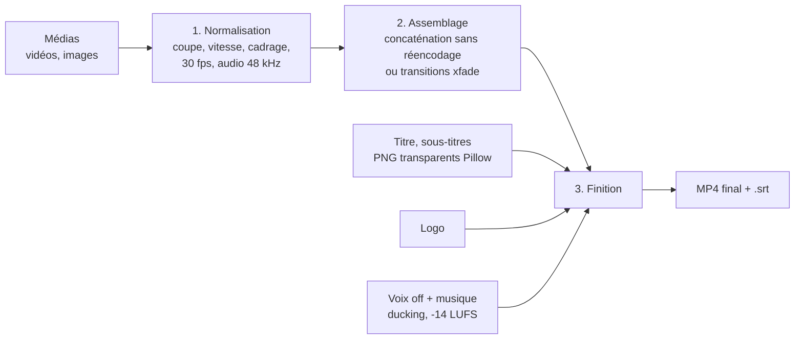

# Montage Studio Video (MSV)

Logiciel de montage vidéo **100 % local** pour produire vite des Shorts, des vidéos YouTube et des séries de vidéos.
L'application et sa documentation sont dans le dossier [`montage_studio/`](montage_studio/).

## 2. Fonctions

| Fonction | Où | Détail |
|---|---|---|
| Couper des extraits | Inspecteur | Curseur image par image, boutons « Début = curseur » / « Fin = curseur » |
| Assembler | Timeline | Ordre, vitesse (0,5 à 4×), volume, cadrage horizontal, durée des images |
| Formats | Format et rendu | 9:16, 16:9, 1:1, 4:5 |
| Cadrage | Format et rendu | **flou** (fond flouté), **rogner** (plein écran), **bandes** (barres noires) |
| Transitions | Format et rendu | fondu enchaîné, fondu au noir, dissolution, glissements, balayage, zoom, cercle |
| Couper les silences | Audio | Détection automatique, seuil et durée réglables |
| Voix off | Audio | Volume, décalage |
| Musique | Audio | Bouclée sur toute la vidéo, fondus, **ducking** (baisse quand on parle) |
| Normalisation | Audio | -14 LUFS, le niveau visé par YouTube |
| Images fixes animées | Images fixes | Zoom avant / arrière (Ken Burns), réparties sur la durée de la voix off |
| Titre | Titre | Police, taille, couleur, position, bandeau, horaires |
| Sous-titres | Sous-titres | Script minuté automatiquement, fichier `.srt` ou Whisper ; **karaoké** (mot prononcé surligné) |
| Logo / filigrane | Logo | 5 positions, taille, opacité |
| Aperçu rapide | Bas de page | Demi-résolution, 3 à 5× plus rapide |
| Export | Bas de page | MP4 H.264 + AAC, `+faststart`, fichier `.srt` généré à côté |
| Accélération GPU | Encodeur | NVIDIA, Apple, Intel ; repli automatique sur le CPU si ça échoue |
| Projets | Projets et modèles | Sauvegarde / chargement en JSON |
| Série | Shorts en série | CSV ou dossier → N vidéos avec le même style |
| Miniatures | Outils rapides | Image de la vidéo + gros texte, 16:9 ou 9:16 |
| Vidéo → Short | Outils rapides | Un clic : 9:16 + silences coupés |
| Extraire l'audio | Outils rapides | MP3 |
| Transcription | Outils rapides | Audio/vidéo → `.srt` (Whisper) |

---

## 3. Comment ça marche

| Module | Rôle |
|---|---|
| `app.py` | Interface (onglets Montage, Shorts en série, Outils rapides, Aide) |
| `cli.py` | Même moteur en ligne de commande |
| `core/render.py` | Moteur : projet JSON → MP4 |
| `core/batch.py` | Production en série (CSV, dossier) |
| `core/subs.py` | SRT, minutage automatique, Whisper |
| `core/textimg.py` | Rendu du texte (titres, sous-titres, karaoké) |
| `core/tools.py` | Silences, captures, miniatures, audio |
| `core/ff.py` | Accès à FFmpeg, analyse des médias, progression |

Dossiers créés à l'usage : `medias/` (copies des fichiers importés), `sorties/` (vidéos), `projets/`, `cache/` (temporaire, vidé après chaque rendu).

---

## 4. Shorts en série

Le **modèle** fixe le style, le **tableau** fixe le contenu. Une ligne = une vidéo terminée.

| Colonne | Contenu | Exemple |
|---|---|---|
| `id` | Nom du fichier produit | `histoire_07` |
| `medias` | Fichiers séparés par `\|`, un dossier, ou un motif | `histoires/07/*.jpg` |
| `titre` | Titre affiché au début | `Le village englouti` |
| `texte` | Script des sous-titres | `En 1954, ...` |
| `srt` | Sous-titres déjà minutés (prioritaire sur `texte`) | `histoires/07/voix.srt` |
| `voix_off` | Narration | `histoires/07/voix.mp3` |
| `musique` | Fond musical | `musiques/tension.mp3` |
| `debut`, `fin` | Portion des vidéos à garder (s) | `12` / `58` |

Séparateur `;`, `,` ou tabulation (un export Excel ou Google Sheets en CSV fonctionne). Les chemins relatifs
partent du « dossier de base » indiqué dans l'interface. Une ligne en erreur n'arrête pas la série : elle est signalée dans le rapport.

**Règle automatique** : si une ligne a des images **et** une voix off, les images se répartissent sur toute la durée de la voix.

### Modèles fournis

| Modèle | Pour quoi | Points clés |
|---|---|---|
| `short_storytelling` | Histoires vraies narrées, images IA | 9:16, zoom avant, fondus, karaoké jaune au centre, musique à 12 % |
| `short_clip_parle` | Extraits filmés, interviews, vlogs | Fond flou, silences coupés, Whisper surligné en violet, titre Anton |
| `short_enfants` | Dessins animés pour tout-petits | Rythme doux, texte non capitalisé, couleurs chaudes |
| `video_youtube_16x9` | Vidéos longues | 16:9, fondus au noir, logo discret, sans sous-titres incrustés |

Pour créer le tien : règle tout dans l'onglet Montage, donne un nom au projet, puis « Enregistrer les réglages comme modèle de série ».

---

