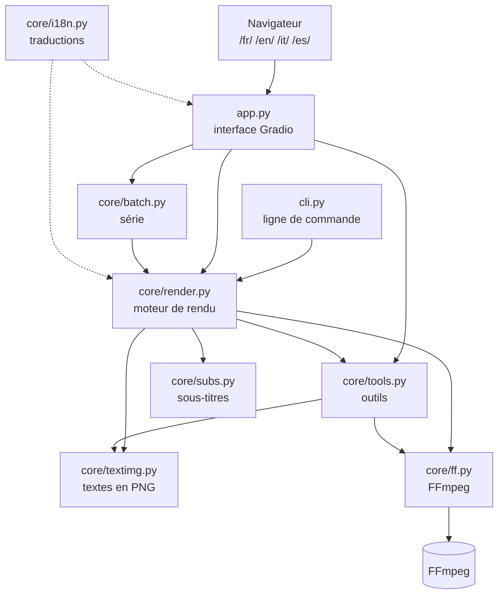
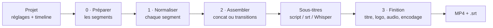

<p align="center"></p>

# Montage Studio : documentation complète

Ce document explique **ce que fait l'application, comment s'en servir, comment elle est construite**, puis contient
**tout le code source**, fichier par fichier.

> Astuce : dans VS Code, ouvre ce fichier puis appuie sur **Ctrl+Shift+V** pour l'afficher mis en forme.

## Sommaire

**Partie 1 : explications**
1. [Ce que fait Montage Studio](#1-ce-que-fait-montage-studio)
2. [Installer et lancer](#2-installer-et-lancer)
3. [Utiliser l'application](#3-utiliser-lapplication)
4. [Organisation des fichiers](#4-organisation-des-fichiers)
5. [Architecture : qui fait quoi](#5-architecture--qui-fait-quoi)
6. [Comment une vidéo est fabriquée](#6-comment-une-vidéo-est-fabriquée)
7. [Le format d'un projet (JSON)](#7-le-format-dun-projet-json)
8. [La production en série (CSV)](#8-la-production-en-série-csv)
9. [Les langues (FR, EN, IT, ES)](#9-les-langues-fr-en-it-es)
10. [La ligne de commande](#10-la-ligne-de-commande)
11. [Le logo](#11-le-logo)
12. [Dépannage](#12-dépannage)

**Partie 2 : [code source complet](#partie-2--code-source-complet)**

---

# Partie 1 : explications

## 1. Ce que fait Montage Studio

Montage Studio est un **logiciel de montage vidéo qui tourne entièrement sur ton ordinateur** (rien n'est envoyé sur
Internet). Il est pensé pour produire vite :

- des **Shorts verticaux 9:16** (YouTube Shorts, TikTok, Reels) ;
- des **vidéos YouTube 16:9** classiques ;
- des **séries de vidéos** au même style, à partir d'un simple tableau.

L'interface s'affiche dans le navigateur, mais c'est ton PC qui fait tout le travail.

| Brique | Rôle |
|---|---|
| **Python** | Le langage dans lequel l'application est écrite. |
| **Gradio** | Fabrique l'interface web (boutons, curseurs, onglets) à partir du code Python. |
| **FFmpeg** | Le moteur vidéo : coupe, assemble, applique les effets, encode le MP4. Il est fourni automatiquement par le paquet `imageio-ffmpeg`. |
| **Pillow** | Dessine les textes (titres, sous-titres, miniatures) en images transparentes. |
| **pandas** | Gère le tableau de la timeline. |
| **faster-whisper** *(optionnel)* | Transcrit la voix en sous-titres, au mot près. |

**Fonctions principales :** couper des extraits, assembler, 4 formats (9:16, 16:9, 1:1, 4:5), 3 cadrages (fond flou,
rogner, bandes noires), 8 transitions, suppression automatique des silences, voix off, musique qui baisse quand on parle
(*ducking*), volume normalisé pour YouTube (-14 LUFS), images animées (effet Ken Burns), titre, sous-titres avec mot
surligné (karaoké), logo en filigrane, accélération GPU, miniatures YouTube, conversion vidéo → Short en un clic,
extraction MP3, transcription `.srt`.

---

## 2. Installer et lancer

**Prérequis :** Python 3.10 ou plus récent (version finale, pas une version « alpha »), installé depuis python.org en
cochant **« Add python.exe to PATH »**.

| Méthode | Comment |
|---|---|
| **Raccourci du Bureau** | Double-clic sur **Montage Studio** (icône violette [ ▶ ]). |
| **Windows** | Double-clic sur `lancer_windows.bat`. |
| **macOS / Linux** | Dans un terminal : `./lancer_mac_linux.sh` |
| **À la main** | `.venv\Scripts\python.exe app.py` |

**Au premier lancement**, le script :
1. trouve Python (il préfère la commande `py -3`, qui choisit la version la plus récente installée) ;
2. vérifie que c'est Python 3.10+ en version finale ;
3. crée un environnement isolé `.venv` (les bibliothèques de l'appli ne touchent pas au reste du PC) ;
4. installe les dépendances de `requirements.txt` ;
5. crée le marqueur `.venv\installed.ok` **seulement si l'installation a réussi** (sinon il réessaie la fois suivante).

Ensuite l'application démarre et ouvre le navigateur sur `http://127.0.0.1:7860`.
La fenêtre noire (réduite dans la barre des tâches) **est** le moteur : la fermer arrête l'application.

**Option Whisper** (sous-titres automatiques) : `.venv\Scripts\python.exe -m pip install faster-whisper`

---

### Version installée (Windows)
L'installateur (`installer/MontageStudioVideo.iss`, compilé par GitHub Actions) copie l'application dans
`%LOCALAPPDATA%\Programs\Montage Studio Video`. Le lanceur `lancer_msv.bat` prépare au premier lancement Python et les
composants avec `uv`, à partir de `requirements.lock`. En mode installé (`MSV_INSTALLED=1`), `core/paths.py` range les
fichiers de l'utilisateur dans `Documents\Montage Studio Video` et les fichiers internes dans
`%LOCALAPPDATA%\MontageStudioVideo`. Lancé depuis le dépôt, tout reste dans le dossier `montage_studio/`, comme avant.

## 3. Utiliser l'application

L'interface a 4 onglets. Le sélecteur **FR · EN · IT · ES** en haut à droite change la langue.

### Onglet « Montage »

| Zone | Ce qu'on y fait |
|---|---|
| **1 · Médiathèque** | Importer des vidéos et images (glisser-déposer, ou chemin d'un dossier du PC). Les fichiers sont copiés dans `medias/`. |
| **2 · Inspecteur** | Choisir un média, déplacer le curseur image par image, fixer **Début** et **Fin**, puis « Ajouter l'extrait à la timeline ». |
| **3 · Timeline** | Tableau modifiable : `ordre`, `fichier`, `début`, `fin`, `vitesse` (0,5 à 4), `volume` (0 à 2), `cadrage_x` (0 = gauche, 1 = droite), `durée_img`. |
| **Réglages (à droite)** | Format et rendu, Audio, Images fixes, Titre, Sous-titres, Logo. « Aperçu du texte » montre le titre et les sous-titres instantanément. |
| **En bas** | **Aperçu rapide** (demi-résolution, 3 à 5× plus rapide) et **Exporter la vidéo**. Le résultat va dans `sorties/` avec un `.srt` à côté. |
| **Projets et modèles** | Enregistrer / charger un projet (`projets/*.json`), enregistrer les réglages comme modèle (`templates/*.json`). |

### Onglet « Voix off »
Écris le texte (scènes séparées par `---`), choisis **Piper** (gratuit, hors ligne) ou **ElevenLabs** (ta clé API),
puis « Générer la voix » : une piste par scène, une piste complète et un `.srt`. « Utiliser dans l'onglet Montage »
règle d'un coup la voix off, les sous-titres et la répartition des images. L'accordéon « Remplacer la voix d'un clip
existant » corrige une scène générée avec la mauvaise voix. Code : `core/voice.py`, tests : `tests/test_voix.py`.

### Onglet « Shorts en série »
Un modèle (le style) + un tableau CSV ou un dossier (le contenu) = autant de vidéos que de lignes. Voir [section 8](#8-la-production-en-série-csv).

### Onglet « Outils rapides »
- **A · Miniature YouTube** : une image de la vidéo + un gros texte, en 16:9 ou 9:16.
- **B · Vidéo → Short 9:16** : conversion en un clic (cadrage + silences coupés).
- **C · Extraire l'audio en MP3.**
- **D · Transcrire en `.srt`** avec Whisper.

### Onglet « Aide »
Rappel des étapes, du format CSV, des modes de sous-titres et des conseils de performance.

---

## 4. Organisation des fichiers

```
montage_studio/
├── app.py                  ← l'interface (Gradio) et le serveur web multilingue
├── cli.py                  ← la même chose en ligne de commande (automatisation)
├── lancer_windows.bat      ← lanceur Windows (installe au 1er lancement)
├── lancer_mac_linux.sh     ← lanceur macOS / Linux
├── requirements.txt        ← liste des bibliothèques Python nécessaires
├── README.md               ← présentation courte
├── DOCUMENTATION.md        ← ce document
│
├── core/                   ← le « moteur », indépendant de l'interface
│   ├── render.py           ← fabrique la vidéo (le cœur du logiciel)
│   ├── ff.py               ← parle à FFmpeg (trouver, analyser, lancer)
│   ├── textimg.py          ← dessine les textes en PNG transparents
│   ├── subs.py             ← sous-titres : SRT, minutage, Whisper
│   ├── tools.py            ← silences, capture d'image, miniatures, audio
│   ├── batch.py            ← production en série (CSV / dossier)
│   └── i18n.py             ← toutes les traductions FR / EN / IT / ES
│
├── assets/                 ← logo (SVG, PNG, ICO) et son script de génération
├── fonts/                  ← polices Anton et Montserrat (licence OFL)
├── templates/              ← modèles de style prêts à l'emploi (JSON)
├── exemples/               ← exemples de tableaux CSV pour la série
│
├── medias/                 ← (créé auto) copies des fichiers importés
├── projets/                ← (créé auto) projets enregistrés
├── sorties/                ← (créé auto) vidéos exportées
├── cache/                  ← (créé auto) fichiers temporaires de rendu
└── .venv/                  ← (créé auto) environnement Python isolé
```

---

## 5. Architecture : qui fait quoi



**Principe clé : l'interface et le moteur sont séparés.**
`app.py` ne fait que collecter les réglages et les transformer en un **projet** (un dictionnaire, voir section 7).
Le moteur `core/render.py` reçoit ce projet et fabrique la vidéo. C'est pour cela que `cli.py` et la production en
série peuvent réutiliser exactement le même moteur.

### Rôle de chaque fichier

| Fichier | Rôle | Fonctions importantes |
|---|---|---|
| `app.py` | Construit l'interface et relie chaque bouton à une action. Sert 4 pages (une par langue). | `build_ui(lang)`, `collect()` (réglages → projet), `project_values()` (projet → réglages), `_render()`, `run_series()`, `build_app()` |
| `core/render.py` | Transforme un projet en MP4. Contient les listes de formats, transitions, qualités, encodeurs et le projet par défaut. | `render_project()`, `merge_defaults()`, `_expand_clips()`, `_render_segment()`, `_assemble()`, `_finalize()` |
| `core/ff.py` | Trouve FFmpeg, analyse un média (durée, taille, son), lance FFmpeg en suivant la progression. | `ffmpeg_exe()`, `probe()`, `run_ffmpeg()`, `run_capture()` |
| `core/textimg.py` | Dessine un texte (contour, ombre, bandeau, mot surligné) sur un calque transparent. | `render_text()`, `load_font()`, `parse_color()` |
| `core/subs.py` | Lit et écrit les `.srt`, minute un script automatiquement, transcrit avec Whisper. | `from_script()`, `parse_srt()`, `write_srt()`, `transcribe()` |
| `core/tools.py` | Détecte les silences, capture une image, fabrique une miniature, extrait l'audio. | `detect_speech_ranges()`, `grab_frame()`, `make_thumbnail()` |
| `core/batch.py` | Lit un CSV (ou un dossier) et rend une vidéo par ligne avec le même modèle. | `read_csv()`, `build_project()`, `run_batch()` |
| `core/i18n.py` | Table de traduction : le texte français sert de clé. | `_()`, `opts()`, `help_text()`, `pick_lang()` |
| `cli.py` | Commandes `rendu`, `serie`, `dossier`. | `main()` |
| `assets/make_logo.py` | Génère le logo dans tous les formats à partir d'une seule géométrie. | `mark_svg()`, `mark_png()`, `lockup_png()` |

---

## 6. Comment une vidéo est fabriquée

Quand tu cliques sur **Exporter la vidéo**, voici ce qui se passe :



**Étape 0 : préparer les segments** (`_expand_clips`)
Chaque ligne de la timeline devient un ou plusieurs *segments*. Si « Couper les silences » est activé, FFmpeg
(`silencedetect`) repère les blancs et l'extrait est découpé en morceaux de parole. Si « Répartir les images sur la voix
off » est coché, la durée des images est calculée pour finir avec la voix.

**Étape 1 : normaliser chaque segment** (`_render_segment`)
Chaque segment est converti en un petit fichier au **format identique** : même taille, 30 images/s, audio stéréo
48 kHz. On applique la coupe, la vitesse, le volume et le cadrage :
- **flou** : la vidéo au centre, sur une copie floutée et assombrie d'elle-même ;
- **rogner** : la vidéo remplit l'écran, les bords sont coupés (`cadrage_x` choisit quelle partie garder) ;
- **bandes** : la vidéo entière, avec des barres noires.

Les images fixes sont cadrées une seule fois avec Pillow (bien plus rapide), puis animées avec `zoompan` (Ken Burns).

**Étape 2 : assembler** (`_assemble`)
- Sans transition : les segments ayant le même format, ils sont collés **sans réencodage** (très rapide).
- Avec transition : FFmpeg mélange les segments deux à deux (`xfade` pour l'image, `acrossfade` pour le son).

**Sous-titres** (`_build_cues` puis `_subtitle_track`)
Les sous-titres sont obtenus selon la source choisie (script minuté automatiquement, fichier `.srt`, ou Whisper). Chaque
sous-titre est dessiné en PNG transparent. En mode karaoké, on dessine une image par mot, avec le mot prononcé
surligné. Ces images forment une « piste » superposée à la vidéo.

**Étape 3 : finition** (`_finalize`)
En une seule commande FFmpeg : superposition du titre, des sous-titres et du logo ; fondus d'ouverture et de fermeture ;
mixage de la voix off ; musique bouclée avec **ducking** (`sidechaincompress` : la musique baisse dès que quelqu'un
parle) ; normalisation à **-14 LUFS** ; encodage H.264 + AAC avec `+faststart` (lecture immédiate sur le web).
Si l'encodeur GPU échoue, le rendu est relancé automatiquement sur le CPU.

**Qualités de rendu :**

| Qualité | Résolution | Vitesse | Usage |
|---|---|---|---|
| `aperçu` | moitié | très rapide | vérifier le montage |
| `standard` | pleine | rapide | brouillons |
| `haute` | pleine | plus lent | publication |

**Pourquoi les textes sont dessinés avec Pillow et pas par FFmpeg ?** Le rendu est ainsi identique sous Windows, macOS
et Linux, sans dépendre des polices du système ni de modules FFmpeg optionnels.

---

## 7. Le format d'un projet (JSON)

Un projet est un simple fichier JSON (dans `projets/`). Tout champ absent prend la valeur par défaut
(`DEFAULT_PROJECT` dans `core/render.py`). Les **valeurs restent en français** quelle que soit la langue de
l'interface : un projet créé en italien s'ouvre sans problème en français.

| Champ | Valeurs possibles | Défaut |
|---|---|---|
| `name` | texte (nom du fichier de sortie) | `projet` |
| `format` | `9:16`, `16:9`, `1:1`, `4:5` | `9:16` |
| `fit` | `flou`, `rogner`, `bandes` | `flou` |
| `fps` | 24, 25, 30, 60 | 30 |
| `quality` | `aperçu`, `standard`, `haute` | `haute` |
| `encoder` | `cpu (x264)`, `nvidia (nvenc)`, `apple (videotoolbox)`, `intel (quicksync)` | `cpu (x264)` |
| `clips` | liste de `{path, start, end, speed, volume, crop_x, duration}` | `[]` |
| `transition` | `{type, duration}` ; type : `aucune`, `fondu enchaîné`, `fondu au noir`, `dissolution`, `glissement gauche`, `glissement haut`, `balayage`, `zoom`, `cercle` | `aucune`, 0,4 s |
| `fade_in`, `fade_out` | secondes | 0 |
| `remove_silence` | `{enabled, threshold_db, min_silence, padding}` | désactivé |
| `normalize_audio` | `true` / `false` | `true` |
| `image_duration` | secondes par image | 3 |
| `image_zoom` | `aucun`, `zoom avant`, `zoom arrière` | `zoom avant` |
| `fit_images_to_voiceover` | `true` / `false` | `false` |
| `voiceover` | `{path, volume, offset}` | vide |
| `music` | `{path, volume, ducking}` | volume 0,18, ducking activé |
| `title` | `{text, start, end, style}` | vide |
| `subtitles` | `{source, script, srt_path, max_words, karaoke, language, whisper_model, style}` ; source : `aucun`, `script`, `srt`, `whisper` | `aucun` |
| `logo` | `{path, position, size, opacity}` ; position : `haut gauche`, `haut droite`, `bas gauche`, `bas droite`, `centre` | `haut droite` |

Un **modèle** (`templates/*.json`) est un projet sans médias. Il peut avoir `description`, et ses traductions
`description_en`, `description_it`, `description_es`.

---

## 8. La production en série (CSV)

**Une ligne du tableau = une vidéo terminée.** Le modèle fixe le style, le tableau fixe le contenu.
Séparateur `;`, `,` ou tabulation. Les noms de colonnes restent en français :

| Colonne | Contenu |
|---|---|
| `id` | nom du fichier de sortie |
| `medias` | fichiers séparés par `\|`, un dossier entier, ou un motif comme `images/*.jpg` |
| `titre` | texte du titre |
| `texte` | script des sous-titres (minuté automatiquement, ou sur la voix off) |
| `srt` | fichier de sous-titres (prioritaire sur `texte`) |
| `voix_off` | fichier audio de narration |
| `musique` | musique de fond |
| `debut`, `fin` | portion à garder des vidéos, en secondes |

Exemple (`exemples/serie_clips.csv`) :
```
id;medias;titre;debut;fin
extrait_interview;rushs/interview.mp4;3 conseils pour débuter;12;58
```

Si une ligne contient des images **et** une voix off, les images sont réparties automatiquement sur la durée de la voix.
Une ligne en erreur n'arrête pas la série : elle est signalée ❌ dans le rapport.

**Mode dossier :** chaque vidéo d'un dossier devient un Short (durée max réglable, titre = nom du fichier en option).

---

## 9. Les langues (FR, EN, IT, ES)

- Le serveur sert **4 pages** : `/fr/`, `/en/`, `/it/`, `/es/`.
- L'adresse racine `/` redirige vers la **dernière langue choisie** (mémorisée dans un cookie), sinon vers la langue du
  navigateur, sinon l'anglais.
- Chaque action (rendu, erreur, journal, progression) s'exécute dans la langue de la page qui l'a lancée.

**Principe :** toute l'application est écrite en français, et chaque texte affiché passe par `_("texte français")`.
Le fichier `core/i18n.py` contient la table `_STRINGS` : une ligne par texte, avec ses traductions.

**Modifier une traduction :** cherche le texte dans `core/i18n.py` et change la colonne voulue.

**Ajouter un texte :** dans le code, écris `_("Mon nouveau texte")`, puis ajoute dans `_STRINGS` :
```python
("Mon nouveau texte", "My new text", "Il mio nuovo testo", "Mi nuevo texto"),
```
Un texte absent de la table s'affiche simplement en français.

**Pour les choix** (boutons radio, listes) : `opts([...])` affiche la traduction mais garde la valeur française, ce qui
garantit que les projets restent compatibles entre les langues.

*Limite :* « Drop File Here / Click to Upload » est un texte interne de Gradio qui suit la langue du navigateur.

---

## 10. La ligne de commande

Pratique pour automatiser (sans interface) :

```bash
# rendre un projet enregistré
.venv\Scripts\python.exe cli.py rendu projets/mon_projet.json -o sorties/final.mp4

# une vidéo par ligne d'un CSV
.venv\Scripts\python.exe cli.py serie templates/short_storytelling.json exemples/serie_storytelling.csv --base D:/chaine --sortie sorties/lot1

# une vidéo par fichier d'un dossier (59 s max)
.venv\Scripts\python.exe cli.py dossier templates/short_clip_parle.json D:/rushs --duree 59 --sortie sorties/clips
```

Options : `--qualite aperçu|standard|haute`, `--titre-nom` (titre = nom du fichier, mode dossier).
Options de `app.py` : `--port 7870` (port précis), `--no-browser` (ne pas ouvrir le navigateur).

---

## 11. Le logo

Le symbole **[ ▶ ]** associe un triangle « lecture » (la vidéo) et deux crochets de coupe (le montage), sur un dégradé
violet → indigo, avec un triangle ambre.

| Fichier (`assets/`) | Usage |
|---|---|
| `logo.svg`, `logo.png` | logo complet, fond clair |
| `logo_dark.svg`, `logo_dark.png` | logo complet, fond sombre |
| `logo_icon.svg`, `logo_icon.png` | icône carrée 512 px (avatar YouTube, réseaux) |
| `favicon.png` | icône de l'onglet du navigateur |
| `montage_studio.ico` | icône Windows (raccourci du Bureau), 16 à 256 px |

Pour modifier les couleurs ou la forme : change les constantes en haut de `assets/make_logo.py`, puis lance
`.venv\Scripts\python.exe assets/make_logo.py`. Tous les fichiers sont régénérés.

---

## 12. Dépannage

| Problème | Solution |
|---|---|
| « Python est introuvable » ou « version finale introuvable » | Installer Python 3.12 depuis python.org en cochant « Add python.exe to PATH ». Désinstaller les versions alpha/bêta. |
| L'installation a échoué | Vérifier la connexion Internet et relancer : l'installation reprend tant qu'elle n'a pas réussi. Pour repartir de zéro : supprimer le dossier `.venv`. |
| `No module named 'gradio'` | Supprimer `.venv` et relancer `lancer_windows.bat`. |
| Le navigateur ne s'ouvre pas | Ouvrir `http://127.0.0.1:7860` à la main (ou le port affiché dans la fenêtre noire). |
| Sous-titres Whisper ignorés | `.venv\Scripts\python.exe -m pip install faster-whisper` |
| Rendu lent | Utiliser « Aperçu rapide » pour vérifier, et l'encodeur « nvidia (nvenc) » si tu as une carte NVIDIA. |
| Erreur FFmpeg dans le journal | Le message indique le fichier en cause ; souvent un média illisible ou un chemin déplacé. |
| Le raccourci du Bureau ne marche plus | Le dossier du projet a été déplacé : recréer le raccourci vers `lancer_windows.bat`. |

---

# Partie 2 : code source complet

> ⚠️ Cette copie du code date de la v1.0.0 : elle n'inclut pas la voix off (`core/voice.py`) ni les changements
> suivants. La référence est toujours le code des fichiers du dépôt.

Le code ci-dessous est la copie exacte des fichiers du projet au moment de la génération de ce document.
Ordre de lecture conseillé : lanceurs → `app.py` → `core/render.py` → les autres modules du moteur.

<a id="sommaire-du-code"></a>

## Sommaire du code

**Lancement**

- [`lancer_windows.bat`](#code-lancer-windows-bat) · 35 lignes
- [`lancer_mac_linux.sh`](#code-lancer-mac-linux-sh) · 10 lignes
- [`requirements.txt`](#code-requirements-txt) · 7 lignes

**Interface**

- [`app.py`](#code-app-py) · 950 lignes
- [`cli.py`](#code-cli-py) · 72 lignes

**Moteur (core/)**

- [`core/render.py`](#code-core-render-py) · 555 lignes
- [`core/ff.py`](#code-core-ff-py) · 167 lignes
- [`core/textimg.py`](#code-core-textimg-py) · 219 lignes
- [`core/subs.py`](#code-core-subs-py) · 139 lignes
- [`core/tools.py`](#code-core-tools-py) · 91 lignes
- [`core/batch.py`](#code-core-batch-py) · 144 lignes
- [`core/i18n.py`](#code-core-i18n-py) · 482 lignes
- [`core/__init__.py`](#code-core---init---py) · 0 lignes

**Logo**

- [`assets/make_logo.py`](#code-assets-make-logo-py) · 145 lignes

**Modèles et exemples**

- [`templates/short_clip_parle.json`](#code-templates-short-clip-parle-json) · 20 lignes
- [`templates/short_storytelling.json`](#code-templates-short-storytelling-json) · 26 lignes
- [`templates/short_enfants.json`](#code-templates-short-enfants-json) · 24 lignes
- [`templates/video_youtube_16x9.json`](#code-templates-video-youtube-16x9-json) · 23 lignes
- [`exemples/serie_clips.csv`](#code-exemples-serie-clips-csv) · 3 lignes
- [`exemples/serie_storytelling.csv`](#code-exemples-serie-storytelling-csv) · 3 lignes

*3115 lignes au total.*

---

## Lancement


<a id="code-lancer-windows-bat"></a>

### `lancer_windows.bat`

Lanceur Windows : trouve Python 3.10+, crée `.venv`, installe les dépendances (et réessaie tant que ce n'est pas réussi), puis démarre l'application.

````bat
@echo off
chcp 65001 >nul
cd /d "%~dp0"
rem Prefere le lanceur "py" (choisit la version de Python la plus recente installee)
set "PY=python"
py -3 -c "" >nul 2>&1 && set "PY=py -3"
if not exist ".venv\Scripts\python.exe" (
  echo Premiere installation, cela prend quelques minutes...
  %PY% -c "import sys; sys.exit(0 if sys.version_info >= (3, 10) and sys.version_info.releaselevel == 'final' else 1)"
  if errorlevel 1 (
    echo Python 3.10 ou plus recent ^(version finale^) est introuvable.
    echo Installe Python depuis python.org en cochant "Add python.exe to PATH", puis relance ce fichier.
    pause
    exit /b 1
  )
  %PY% -m venv .venv
  if errorlevel 1 (
    echo Impossible de creer l'environnement .venv
    pause
    exit /b 1
  )
)
rem Installe les dependances tant qu'une installation n'a pas reussi (marqueur .venv\installed.ok)
if not exist ".venv\installed.ok" (
  ".venv\Scripts\python.exe" -m pip install --upgrade pip
  ".venv\Scripts\python.exe" -m pip install -r requirements.txt
  if errorlevel 1 (
    echo L'installation des dependances a echoue. Verifie ta connexion puis relance ce fichier.
    pause
    exit /b 1
  )
  echo ok> ".venv\installed.ok"
)
".venv\Scripts\python.exe" app.py
pause
````

[↑ Retour au sommaire du code](#sommaire-du-code)


<a id="code-lancer-mac-linux-sh"></a>

### `lancer_mac_linux.sh`

Lanceur macOS / Linux, même principe.

````bash
#!/usr/bin/env bash
set -e
cd "$(dirname "$0")"
if [ ! -x ".venv/bin/python" ]; then
  echo "Première installation, cela prend quelques minutes..."
  python3 -m venv .venv
  .venv/bin/python -m pip install --upgrade pip
  .venv/bin/python -m pip install -r requirements.txt
fi
.venv/bin/python app.py
````

[↑ Retour au sommaire du code](#sommaire-du-code)


<a id="code-requirements-txt"></a>

### `requirements.txt`

Bibliothèques Python installées dans `.venv`.

````text
gradio>=6.0,<7
imageio-ffmpeg>=0.5
pillow>=10.1
pandas>=2.0

# Optionnel : sous-titres automatiques au mot près (Whisper)
# faster-whisper>=1.0
````

[↑ Retour au sommaire du code](#sommaire-du-code)


## Interface


<a id="code-app-py"></a>

### `app.py`

L'interface Gradio et le serveur web. Sections : utilitaires, conversion réglages ⇄ projet, actions des boutons (médiathèque, rendu, projets, série, outils), style (CSS + thème), construction de l'interface `_build_ui(lang)`, puis serveur multilingue `build_app()`.

````python
"""Montage Studio : interface locale de montage vidéo (Gradio + FFmpeg).

Lancer :  python app.py      puis ouvrir http://127.0.0.1:7860
Interface en 4 langues : /fr/, /en/, /it/, /es/ (la racine choisit d'après le navigateur ou le dernier choix).
"""
from __future__ import annotations

import copy
import functools
import json
import math
import re
import shutil
import socket
import threading
import time
import webbrowser
from pathlib import Path

import gradio as gr
from fastapi import FastAPI, Request
from fastapi.responses import FileResponse, RedirectResponse
import pandas as pd
from PIL import Image

from core import batch, ff, subs, tools
from core.i18n import DEFAULT_LANG, LANG, LANGS, _, help_text, opts, pick_lang
from core.render import (DEFAULT_PROJECT, ENCODERS, FORMATS, QUALITY, TRANSITIONS,
                         fit_image, merge_defaults, render_project)
from core.textimg import DEFAULT_STYLE, list_fonts, render_text

BASE = Path(__file__).resolve().parent
MEDIA_DIR = BASE / "medias"
OUT_DIR = BASE / "sorties"
PROJ_DIR = BASE / "projets"
TPL_DIR = BASE / "templates"
for d in (MEDIA_DIR, OUT_DIR, PROJ_DIR, TPL_DIR):
    d.mkdir(exist_ok=True)

COLS = ["ordre", "fichier", "début", "fin", "vitesse", "volume", "cadrage_x", "durée_img"]
FROM_MONTAGE = "(réglages de l'onglet Montage)"   # valeur interne ; seul le libellé affiché est traduit
FONTS = list_fonts()

# --------------------------------------------------------------------------- utilitaires

def slug(s: str) -> str:
    s = re.sub(r"[^\w\-]+", "_", (s or "video").strip()).strip("_")
    return s or "video"


def num(x, default=None):
    try:
        v = float(x)
        return default if math.isnan(v) else v
    except (TypeError, ValueError):
        return default


def persist(path) -> str:
    """Copie un fichier envoyé par le navigateur dans medias/ pour qu'il survive au redémarrage."""
    if not path:
        return ""
    p = Path(path if isinstance(path, str) else getattr(path, "name", str(path)))
    if not p.exists():
        return str(p)
    try:
        p.resolve().relative_to(BASE)
        return str(p.resolve())
    except ValueError:
        pass
    dest = MEDIA_DIR / p.name
    if dest.exists() and dest.stat().st_size != p.stat().st_size:
        dest = MEDIA_DIR / f"{p.stem}_{int(time.time())}{p.suffix}"
    if not dest.exists():
        shutil.copy2(p, dest)
    return str(dest)


def get_path(d: dict, key: str, default=None):
    for k in key.split("."):
        if not isinstance(d, dict) or k not in d:
            return default
        d = d[k]
    return d


def set_path(d: dict, key: str, value) -> None:
    ks = key.split(".")
    for k in ks[:-1]:
        d = d.setdefault(k, {})
    d[ks[-1]] = value


def to_rows(df) -> list[list]:
    if df is None:
        return []
    if hasattr(df, "values"):
        return df.values.tolist()
    return [r for r in df if r]


def cols() -> list[str]:
    """En-têtes de la timeline dans la langue active (les colonnes sont lues par position)."""
    return [_(c) for c in COLS]


def empty_df() -> pd.DataFrame:
    return pd.DataFrame(columns=cols())


def df_from_rows(rows) -> pd.DataFrame:
    return pd.DataFrame(rows, columns=cols()) if rows else empty_df()


def clips_from_df(df) -> list[dict]:
    rows = [r for r in to_rows(df) if len(r) >= 2 and str(r[1] or "").strip() not in ("", "nan")]
    rows.sort(key=lambda r: num(r[0], 9999))
    clips = []
    for r in rows:
        c = {"path": str(r[1]).strip()}
        for key, idx in (("start", 2), ("end", 3), ("speed", 4), ("volume", 5), ("crop_x", 6), ("duration", 7)):
            v = num(r[idx])
            if v is not None:
                c[key] = v
        clips.append(c)
    return clips


def df_from_clips(clips: list[dict]) -> pd.DataFrame:
    rows = []
    for i, c in enumerate(clips, 1):
        rows.append([i, c.get("path", ""), c.get("start"), c.get("end"), c.get("speed", 1.0),
                     c.get("volume", 1.0), c.get("crop_x", 0.5), c.get("duration")])
    return df_from_rows(rows)


def media_label(path: str) -> str:
    try:
        i = ff.probe(path)
        if i.kind == "image":
            return f"🖼 {Path(path).name}  ({i.width}×{i.height})"
        if i.kind == "audio":
            return f"🎵 {Path(path).name}  ({i.duration:.1f} s)"
        return f"🎬 {Path(path).name}  ({i.duration:.1f} s, {i.width}×{i.height})"
    except Exception:
        return Path(path).name


def template_choices() -> list:
    return [(_(FROM_MONTAGE), FROM_MONTAGE)] + sorted(p.stem for p in TPL_DIR.glob("*.json"))


# --------------------------------------------------------------------------- réglages ⇄ projet

DEF = merge_defaults({})
SUB_STYLE = {**DEFAULT_STYLE, **DEF["subtitles"]["style"]}
TITLE_STYLE = {**DEFAULT_STYLE, **DEF["title"]["style"]}
FIELDS: dict[str, gr.components.Component] = {}
FILE_FIELDS = {"voiceover.path", "music.path", "subtitles.srt_path", "logo.path"}


def reg(key: str, comp):
    FIELDS[key] = comp
    return comp


def default_value(key: str):
    if key.startswith("subtitles.style."):
        return SUB_STYLE.get(key.split(".")[-1])
    if key.startswith("title.style."):
        return TITLE_STYLE.get(key.split(".")[-1])
    return get_path(DEF, key)


def collect(values) -> dict:
    proj = {}
    for key, v in zip(FIELDS.keys(), values):
        if key in FILE_FIELDS:
            v = persist(v) if v else ""
        if key == "fps":
            v = int(v or 30)
        set_path(proj, key, v)
    return merge_defaults(proj)


def project_values(proj: dict) -> list:
    p = merge_defaults(proj)
    out = []
    for key in FIELDS:
        v = get_path(p, key)
        if v is None:
            v = default_value(key)
        if key in FILE_FIELDS:
            v = v if v and Path(v).exists() else None
        if key.startswith(("subtitles.style.", "title.style.")):
            base = SUB_STYLE if key.startswith("subtitles") else TITLE_STYLE
            v = get_path(p, key, base.get(key.split(".")[-1]))
        out.append(v)
    return out


# --------------------------------------------------------------------------- actions : médiathèque & inspecteur

def import_files(files, lib):
    lib = list(lib or [])
    for f in files or []:
        p = persist(f)
        if p and p not in lib:
            lib.append(p)
    return lib, gr.Dropdown(choices=[(media_label(p), p) for p in lib], value=lib[-1] if lib else None), None


def import_folder(folder, lib):
    lib = list(lib or [])
    d = Path((folder or "").strip().strip('"'))
    if not d.is_dir():
        raise gr.Error(_("Dossier introuvable : {d}", d=d))
    for f in sorted(d.iterdir()):
        if f.suffix.lower() in (ff.VIDEO_EXT | ff.IMAGE_EXT | ff.AUDIO_EXT) and str(f) not in lib:
            lib.append(str(f.resolve()))
    return lib, gr.Dropdown(choices=[(media_label(p), p) for p in lib], value=lib[-1] if lib else None)


def inspect_media(path):
    if not path:
        return None, gr.Slider(maximum=1, value=0), _("Choisis un média."), 0, 0
    info = ff.probe(path)
    if info.kind == "audio":
        return None, gr.Slider(maximum=max(1, info.duration), value=0), \
            _("Fichier audio ({dur:.1f} s) : utilise-le comme voix off ou musique.", dur=info.duration), 0, info.duration
    frame = tools.grab_frame(path, 0)
    dur = info.duration if info.kind == "video" else 0
    txt = (f"**{Path(path).name}** · {info.width}×{info.height} · "
           + (f"{dur:.2f} s · {_('avec son') if info.has_audio else _('sans son')}" if info.kind == "video"
              else _("image fixe")))
    return frame, gr.Slider(maximum=max(0.1, round(dur, 2)), value=0, step=0.04), txt, 0, round(dur, 2)


def seek(path, t):
    if not path:
        return None
    return tools.grab_frame(path, float(t or 0))


def add_clip(df, path, start, end):
    if not path:
        raise gr.Error(_("Choisis d'abord un média dans la médiathèque."))
    if ff.media_kind(path) == "audio":
        raise gr.Error(_("Un fichier audio va dans « Voix off » ou « Musique », pas dans la timeline."))
    rows = to_rows(df)
    is_img = ff.media_kind(path) == "image"
    rows.append([len(rows) + 1, path, None if is_img else num(start, 0), None if is_img else num(end),
                 1.0, 1.0, 0.5, None])
    return df_from_rows(rows)


def add_all(df, lib):
    rows = to_rows(df)
    for p in lib or []:
        if ff.media_kind(p) in ("video", "image"):
            rows.append([len(rows) + 1, p, None, None, 1.0, 1.0, 0.5, None])
    return df_from_rows(rows)


def tidy(df):
    rows = sorted(to_rows(df), key=lambda r: num(r[0], 9999))
    rows = [r for r in rows if str(r[1] or "").strip() not in ("", "nan")]
    for i, r in enumerate(rows, 1):
        r[0] = i
    return df_from_rows(rows)


def drop_last(df):
    rows = to_rows(df)[:-1]
    return df_from_rows(rows)


# --------------------------------------------------------------------------- actions : rendu

def _render(df, values, quality, progress):
    proj = collect(values)
    proj["clips"] = clips_from_df(df)
    if not proj["clips"]:
        raise gr.Error(_("La timeline est vide : ajoute au moins une vidéo ou une image."))
    name = slug(proj.get("name"))
    suffix = "_apercu" if quality == "aperçu" else ""
    out = OUT_DIR / f"{name}_{time.strftime('%Y%m%d_%H%M%S')}{suffix}.mp4"
    try:
        res = render_project(proj, out, progress=lambda f, m: progress(f, desc=m), quality=quality)
    except Exception as e:
        raise gr.Error(str(e)[:900])
    files = [res["video"]] + ([res["srt"]] if res.get("srt") else [])
    msg = (_("✅ {name} : {dur:.1f} s de vidéo, rendue en {sec:.0f} s", name=Path(res["video"]).name,
               dur=res["duration"], sec=res["seconds"]) + f"\n📁 {res['video']}\n" + res["log"])
    return res["video"], files, msg


def render_preview(df, *values, progress=gr.Progress()):
    return _render(df, values, "aperçu", progress)


def render_final(df, *values, progress=gr.Progress()):
    proj_q = values[list(FIELDS).index("quality")]
    return _render(df, values, proj_q, progress)


def style_preview(df, *values):
    """Aperçu instantané du titre et des sous-titres sur la première image de la timeline."""
    proj = collect(values)
    W, H = FORMATS[proj["format"]]
    W, H = W // 2, H // 2
    clips = clips_from_df(df)
    base = None
    if clips:
        try:
            c = clips[0]
            src = c["path"]
            if ff.media_kind(src) == "video":
                src = tools.grab_frame(src, c.get("start", 0) or 0, height=0)
            base = fit_image(src, W, H, proj["fit"], c.get("crop_x", 0.5) or 0.5)
        except Exception:
            base = None
    if base is None:
        base = Image.linear_gradient("L").resize((W, H)).convert("RGB")
    img = base.convert("RGBA")
    if str(proj["title"].get("text", "")).strip():
        img = render_text(proj["title"]["text"], W, H, {**DEFAULT_STYLE, **proj["title"]["style"]}, base=img)
    st = proj["subtitles"]
    sample = (st.get("script") or _("Voici un exemple de sous-titres")).split()
    sample = " ".join(sample[: int(st.get("max_words") or 3)])
    img = render_text(sample, W, H, {**DEFAULT_STYLE, **st["style"]}, base=img,
                      highlight_index=1 if st.get("karaoke") and len(sample.split()) > 1 else None)
    return img.convert("RGB")


# --------------------------------------------------------------------------- actions : projets & modèles

def save_project_ui(df, *values):
    proj = collect(values)
    proj["clips"] = clips_from_df(df)
    path = PROJ_DIR / f"{slug(proj['name'])}.json"
    path.write_text(json.dumps(proj, ensure_ascii=False, indent=2), encoding="utf-8")
    gr.Info(_("Projet enregistré : projets/{name}", name=path.name))
    return str(path)


def load_project_ui(file):
    if not file:
        raise gr.Error(_("Choisis un fichier de projet .json."))
    proj = json.loads(Path(file).read_text(encoding="utf-8"))
    return [df_from_clips(proj.get("clips", []))] + project_values(proj)


def save_template_ui(*values):
    proj = collect(values)
    for k in ("clips",):
        proj.pop(k, None)
    proj["voiceover"]["path"] = ""
    proj["subtitles"]["script"] = ""
    proj["subtitles"]["srt_path"] = ""
    proj["title"]["text"] = ""
    name = slug(proj["name"])
    (TPL_DIR / f"{name}.json").write_text(json.dumps(proj, ensure_ascii=False, indent=2), encoding="utf-8")
    gr.Info(_("Modèle enregistré : templates/{name}.json", name=name))
    return gr.Dropdown(choices=template_choices(), value=name)


def load_template_into_montage(name):
    if not name or name == FROM_MONTAGE:
        raise gr.Error(_("Choisis un modèle enregistré."))
    proj = json.loads((TPL_DIR / f"{name}.json").read_text(encoding="utf-8"))
    return project_values(proj)


# --------------------------------------------------------------------------- actions : série

def template_info(name):
    if not name or name == FROM_MONTAGE:
        return _("Les réglages actuels de l'onglet Montage serviront de modèle.")
    try:
        d = json.loads((TPL_DIR / f"{name}.json").read_text(encoding="utf-8"))
        return (d.get(f"description_{LANG.get()}") or d.get("description")
                or _("Modèle {name} ({fmt}).", name=name, fmt=d.get("format", "?")))
    except Exception as e:
        return _("Modèle illisible : {e}", e=e)


def run_series(mode, csv_file, base_dir, folder, max_dur, title_from_name, out_name, quality, tpl,
               *values, progress=gr.Progress()):
    if tpl == FROM_MONTAGE or not tpl:
        template = collect(values)
    else:
        template = merge_defaults(json.loads((TPL_DIR / f"{tpl}.json").read_text(encoding="utf-8")))
    if mode == "Tableau CSV":
        if not csv_file:
            raise gr.Error(_("Ajoute le fichier CSV de la série."))
        rows = batch.read_csv(csv_file)
        base = Path(base_dir.strip().strip('"')) if base_dir and base_dir.strip() else MEDIA_DIR
    else:
        d = Path((folder or "").strip().strip('"'))
        if not d.is_dir():
            raise gr.Error(_("Dossier introuvable : {d}", d=d))
        rows = batch.folder_rows(d, float(max_dur or 0), bool(title_from_name))
        base = d
    if not rows:
        raise gr.Error(_("Aucune ligne à traiter."))
    out = OUT_DIR / slug(out_name or f"serie_{time.strftime('%Y%m%d_%H%M')}")
    files, log = batch.run_batch(template, rows, base, out, quality=quality,
                                 progress=lambda f, m: progress(f, desc=m))
    head = _("{ok}/{n} vidéos dans {out}", ok=len([f for f in files if f.endswith(".mp4")]), n=len(rows), out=out) + "\n\n"
    return files or None, head + log


# --------------------------------------------------------------------------- actions : outils

def tool_thumbnail(file, t, text, fmt, font, size, color, pos):
    if not file:
        raise gr.Error(_("Ajoute une vidéo ou une image."))
    sz = (1280, 720) if fmt.startswith("16:9") else (1080, 1920)
    out = OUT_DIR / f"miniature_{time.strftime('%Y%m%d_%H%M%S')}.jpg"
    tools.make_thumbnail(file, float(t or 0), text or "", str(out), sz,
                         {"font": font, "size": size, "color": color, "position": pos})
    return str(out), str(out)


def tool_quick_short(file, fit, max_dur, silence, progress=gr.Progress()):
    if not file:
        raise gr.Error(_("Ajoute une vidéo."))
    proj = {"name": Path(file).stem + "_short", "format": "9:16", "fit": fit,
            "clips": [{"path": file, "end": float(max_dur) if max_dur else None}],
            "remove_silence": {"enabled": bool(silence)}}
    out = OUT_DIR / f"{slug(proj['name'])}_{time.strftime('%H%M%S')}.mp4"
    res = render_project(proj, out, progress=lambda f, m: progress(f, desc=m), quality="standard")
    return res["video"], res["video"]


def tool_audio(file):
    if not file:
        raise gr.Error(_("Ajoute une vidéo."))
    out = OUT_DIR / f"{Path(file).stem}_audio.mp3"
    ff.run_ffmpeg(["-i", file, "-vn", "-c:a", "libmp3lame", "-q:a", "2", str(out)])
    return str(out)


def tool_transcribe(file, lang, model, max_words, progress=gr.Progress()):
    if not subs.whisper_available():
        raise gr.Error(_("Whisper n'est pas installé. Lance : pip install faster-whisper"))
    if not file:
        raise gr.Error(_("Ajoute un fichier audio ou vidéo."))
    progress(0.1, desc=_("Transcription en cours (le premier lancement télécharge le modèle)"))
    src = file
    if ff.media_kind(file) == "video":
        src = str(OUT_DIR / "tmp_transcription.wav")
        tools.extract_audio(file, src)
    cues = subs.transcribe(src, lang or None, model, int(max_words))
    out = OUT_DIR / f"{Path(file).stem}.srt"
    subs.write_srt(cues, out)
    return str(out), "\n".join(f"[{c['start']:.1f} → {c['end']:.1f}] {c['text']}" for c in cues[:200])


# --------------------------------------------------------------------------- interface

ASSETS = BASE / "assets"
LOGO_SVG = (ASSETS / "logo_icon.svg").read_text(encoding="utf-8") if (ASSETS / "logo_icon.svg").exists() else ""

CSS = """
.gradio-container {max-width: 1480px !important; margin: 0 auto !important;}

/* ---- en-tête */
#entete {display: flex; align-items: center; gap: 16px; padding: 18px 22px; margin-bottom: 6px;
         border-radius: 18px; border: 1px solid var(--border-color-primary);
         background: linear-gradient(120deg, rgba(139,92,246,.12), rgba(67,56,202,.06) 55%, rgba(251,191,36,.08));}
#entete .marque {width: 52px; height: 52px; flex: none; filter: drop-shadow(0 6px 14px rgba(91,33,182,.35));}
#entete .marque svg {width: 100%; height: 100%; display: block;}
#entete .titres {flex: 1; min-width: 0;}
#entete h1 {font-size: 1.65rem; font-weight: 800; margin: 0; letter-spacing: -0.03em; line-height: 1.1;}
#entete h1 span {font-weight: 500; letter-spacing: 0.18em; font-size: 0.62em; text-transform: uppercase;
                 margin-left: 8px; color: var(--body-text-color-subdued);}
#entete p {margin: 4px 0 0; font-size: 0.92rem; color: var(--entete-sous-titre, #52525B);}
.dark #entete p {color: #A1A1AA;}
#entete .droite {display: flex; flex-direction: column; align-items: flex-end; gap: 10px;}
#entete .badges {display: flex; gap: 8px; flex-wrap: wrap; justify-content: flex-end;}
#entete .langues {display: inline-flex; gap: 2px; padding: 3px; border-radius: 10px;
                  background: var(--background-fill-primary); border: 1px solid var(--border-color-primary);}
#entete .langues a {font-size: 0.74rem; font-weight: 700; letter-spacing: 0.04em; padding: 4px 9px; border-radius: 7px;
                    text-decoration: none; color: var(--body-text-color-subdued);}
#entete .langues a:hover {color: var(--body-text-color); background: var(--background-fill-secondary);}
#entete .langues a.actif {color: #fff; background: linear-gradient(135deg, #8B5CF6, #4F46E5);}
#entete .badge {font-size: 0.75rem; font-weight: 600; padding: 5px 11px; border-radius: 999px; white-space: nowrap;
                background: var(--background-fill-primary); border: 1px solid var(--border-color-primary);}
#entete .badge b {color: #7C3AED;}
@media (max-width: 720px) {#entete {flex-wrap: wrap;} #entete .droite {align-items: flex-start;}
                           #entete .badges {justify-content: flex-start;}}

/* ---- groupes : fond clair continu au lieu des bandes grises */
.gr-group, .gr-group > .styler {background: var(--block-background-fill) !important;}

/* ---- onglets */
button[role="tab"] {font-weight: 600 !important; font-size: 0.95rem !important;}

/* ---- titres de section numérotés */
.section-titre {padding: 10px 12px 2px !important;}
.section-titre p {margin: 0 !important; font-weight: 700; font-size: 0.98rem; display: flex; align-items: center; gap: 10px;}
.section-titre .num {display: inline-grid; place-items: center; width: 24px; height: 24px; border-radius: 8px;
                     font-size: 0.78rem; font-weight: 800; color: #fff; flex: none;
                     background: linear-gradient(135deg, #8B5CF6, #4338CA);}
.section-titre em {font-style: normal; font-weight: 500; font-size: 0.85rem; color: #71717A;}
.dark .section-titre em {color: #A1A1AA;}

/* ---- boutons d'action */
#rendu-final {min-height: 54px; font-size: 1.05rem; font-weight: 700; letter-spacing: 0.01em;
              box-shadow: 0 10px 24px -10px rgba(91,33,182,.7);}
#apercu-rapide {min-height: 54px; font-size: 1rem; font-weight: 600;}
.mono textarea {font-family: ui-monospace, "Cascadia Code", Consolas, monospace; font-size: 0.82rem;}

/* ---- pied de page */
#pied {text-align: center; font-size: 0.8rem; color: var(--body-text-color-subdued); padding: 10px 0 4px;}
"""

SYSTEM_FONT = ["Segoe UI Variable Text", "Segoe UI", "ui-sans-serif", "system-ui", "-apple-system", "Roboto",
               "Helvetica Neue", "Arial", "sans-serif"]
THEME = gr.themes.Base(
    primary_hue="violet", secondary_hue="amber", neutral_hue="zinc", radius_size="lg", spacing_size="md",
    font=SYSTEM_FONT, font_mono=["Cascadia Code", "Consolas", "ui-monospace", "monospace"],
).set(
    body_background_fill="#F6F5FA",
    body_background_fill_dark="#0E0E12",
    block_background_fill="#FFFFFF",
    block_background_fill_dark="#18181D",
    block_border_color="#E7E5EF",
    block_border_color_dark="#2A2A33",
    block_shadow="0 1px 2px rgba(24,24,27,.04), 0 4px 16px -8px rgba(24,24,27,.08)",
    block_title_text_weight="600",
    block_label_text_weight="600",
    input_background_fill="#FAFAFC",
    input_background_fill_dark="#111116",
    button_primary_background_fill="linear-gradient(135deg, #8B5CF6, #4F46E5)",
    button_primary_background_fill_hover="linear-gradient(135deg, #7C3AED, #4338CA)",
    button_primary_background_fill_dark="linear-gradient(135deg, #8B5CF6, #4F46E5)",
    button_primary_background_fill_hover_dark="linear-gradient(135deg, #A78BFA, #6366F1)",
    button_primary_text_color="#FFFFFF",
    button_primary_border_color="transparent",
    button_primary_border_color_dark="transparent",
    button_large_radius="14px",
    button_secondary_background_fill="#F3F0FD",
    button_secondary_background_fill_hover="#E9E3FC",
    button_secondary_background_fill_dark="#24212E",
    button_secondary_background_fill_hover_dark="#2E2A3B",
    button_secondary_text_color="#4C1D95",
    button_secondary_text_color_dark="#E4DEFF",
    button_secondary_border_color="#E4DCFA",
    button_secondary_border_color_dark="#363141",
    slider_color="#7C3AED",
    slider_color_dark="#A78BFA",
)

def entete(lang: str) -> str:
    langues = "".join('<a href="/langue/{0}" class="{1}" title="{2}">{3}</a>'.format(
        code, "actif" if code == lang else "", nom, code.upper()) for code, nom in LANGS.items())
    return f"""
<div id="entete">
  <div class="marque">{LOGO_SVG}</div>
  <div class="titres">
    <h1>Montage<span>Studio</span></h1>
    <p>{_("Montage vidéo local pour Shorts et vidéos YouTube, propulsé par FFmpeg.")}</p>
  </div>
  <div class="droite">
    <nav class="langues" aria-label="{_("Langue de l'interface")}">{langues}</nav>
    <div class="badges">
      <span class="badge"><b>●</b> {_("100 % local")}</span>
      <span class="badge">9:16 · 16:9 · 1:1 · 4:5</span>
      <span class="badge">GPU NVIDIA / Apple / Intel</span>
    </div>
  </div>
</div>
"""


def section(num: str, titre: str, note: str = "") -> gr.Markdown:
    """Titre de section avec pastille numérotée (textes traduits)."""
    extra = f" <em>{_(note)}</em>" if note else ""
    return gr.Markdown(f"<span class='num'>{num}</span>{_(titre)}{extra}", elem_classes="section-titre")


def bind(fn, lang: str):
    """Exécute une action dans la langue de la page qui l'a déclenchée."""
    @functools.wraps(fn)
    def wrapper(*args, **kwargs):
        token = LANG.set(lang)
        try:
            return fn(*args, **kwargs)
        finally:
            LANG.reset(token)
    return wrapper


def build_ui(lang: str = DEFAULT_LANG) -> gr.Blocks:
    token = LANG.set(lang)
    try:
        return _build_ui(lang)
    finally:
        LANG.reset(token)


def _build_ui(lang: str) -> gr.Blocks:
    FIELDS.clear()
    L = functools.partial(bind, lang=lang)
    with gr.Blocks(title="Montage Studio") as demo:
        gr.HTML(entete(lang))
        lib = gr.State([])

        with gr.Tab(_("Montage")):
            with gr.Row(equal_height=False):
                # ---------------- colonne gauche : médias, inspecteur, timeline
                with gr.Column(scale=3):
                    with gr.Group():
                        section("1", "Médiathèque", "vidéos et images")
                        with gr.Row():
                            up = gr.File(label=_("Importer des fichiers"), file_count="multiple", type="filepath",
                                         height=110, scale=3)
                            with gr.Column(scale=2, min_width=200):
                                folder_in = gr.Textbox(label=_("ou un dossier de ton PC"),
                                                       placeholder="C:\\Users\\jack\\Videos\\rushs")
                                folder_btn = gr.Button(_("Importer le dossier"), size="sm")
                    with gr.Group():
                        section("2", "Inspecteur", "choisis le début et la fin")
                        media_dd = gr.Dropdown(label=_("Média"), choices=[], interactive=True)
                        with gr.Row():
                            frame_img = gr.Image(label=_("Image au curseur"), height=300, interactive=False, scale=3)
                            with gr.Column(scale=2, min_width=220):
                                media_info = gr.Markdown(_("Importe un média pour commencer."))
                                cursor = gr.Slider(0, 1, value=0, step=0.04, label=_("Curseur (s)"))
                                with gr.Row():
                                    start_n = gr.Number(label=_("Début"), value=0, precision=2, min_width=80)
                                    end_n = gr.Number(label=_("Fin"), value=0, precision=2, min_width=80)
                                with gr.Row():
                                    set_start = gr.Button(_("Début = curseur"), size="sm")
                                    set_end = gr.Button(_("Fin = curseur"), size="sm")
                                add_btn = gr.Button(_("Ajouter l'extrait à la timeline"), variant="primary", size="sm")
                    with gr.Group():
                        section("3", "Timeline", "les cellules sont modifiables")
                        timeline = gr.Dataframe(
                            value=empty_df(), headers=cols(), interactive=True, wrap=True,
                            datatype=["number", "str", "number", "number", "number", "number", "number", "number"],
                            column_count=(len(COLS), "fixed"),
                        )
                        with gr.Row():
                            add_all_btn = gr.Button(_("Ajouter toute la médiathèque"), size="sm")
                            tidy_btn = gr.Button(_("Trier et renuméroter"), size="sm")
                            drop_btn = gr.Button(_("Retirer la dernière ligne"), size="sm")
                            clear_btn = gr.Button(_("Vider"), size="sm", variant="stop")

                # ---------------- colonne droite : réglages
                with gr.Column(scale=2):
                    reg("name", gr.Textbox(label=_("Nom du projet"), value=DEF["name"]))
                    with gr.Accordion(_("Format et rendu"), open=True):
                        reg("format", gr.Radio(list(FORMATS), value=DEF["format"], label=_("Format")))
                        reg("fit", gr.Radio(opts(["flou", "rogner", "bandes"]), value=DEF["fit"], label=_("Cadrage"),
                                            info=_("flou = fond flouté, rogner = plein écran, bandes = barres noires")))
                        with gr.Row():
                            reg("fps", gr.Dropdown([24, 25, 30, 60], value=DEF["fps"], label=_("Images/s")))
                            reg("quality", gr.Dropdown(opts(QUALITY), value=DEF["quality"], label=_("Qualité export")))
                            reg("encoder", gr.Dropdown(list(ENCODERS), value=DEF["encoder"], label=_("Encodeur")))
                        with gr.Row():
                            reg("transition.type", gr.Dropdown(opts(TRANSITIONS), value=DEF["transition"]["type"],
                                                               label=_("Transition")))
                            reg("transition.duration", gr.Slider(0.1, 1.5, value=DEF["transition"]["duration"],
                                                                 step=0.05, label=_("Durée transition (s)")))
                        with gr.Row():
                            reg("fade_in", gr.Slider(0, 3, value=DEF["fade_in"], step=0.1, label=_("Ouverture au noir (s)")))
                            reg("fade_out", gr.Slider(0, 3, value=DEF["fade_out"], step=0.1, label=_("Fermeture au noir (s)")))

                    with gr.Accordion(_("Audio"), open=False):
                        reg("voiceover.path", gr.File(label=_("Voix off"), type="filepath", height=90,
                                                      file_types=sorted(ff.AUDIO_EXT)))
                        with gr.Row():
                            reg("voiceover.volume", gr.Slider(0, 2, value=1.0, step=0.05, label=_("Volume voix")))
                            reg("voiceover.offset", gr.Slider(0, 10, value=0, step=0.1, label=_("Décalage voix (s)")))
                        reg("music.path", gr.File(label=_("Musique de fond (bouclée)"), type="filepath", height=90,
                                                  file_types=sorted(ff.AUDIO_EXT)))
                        with gr.Row():
                            reg("music.volume", gr.Slider(0, 1, value=DEF["music"]["volume"], step=0.01,
                                                          label=_("Volume musique")))
                            reg("music.ducking", gr.Checkbox(value=True, label=_("Baisser la musique quand on parle")))
                        reg("normalize_audio", gr.Checkbox(value=True, label=_("Normaliser le volume (-14 LUFS, cible YouTube)")))
                        reg("remove_silence.enabled", gr.Checkbox(value=False, label=_("Couper les silences automatiquement")))
                        with gr.Row():
                            reg("remove_silence.threshold_db", gr.Slider(-60, -20, value=-35, step=1,
                                                                         label=_("Seuil de silence (dB)")))
                            reg("remove_silence.min_silence", gr.Slider(0.2, 2, value=0.45, step=0.05,
                                                                        label=_("Silence minimum (s)")))

                    with gr.Accordion(_("Images fixes"), open=False):
                        reg("image_duration", gr.Slider(1, 12, value=DEF["image_duration"], step=0.5,
                                                        label=_("Durée par image (s)")))
                        reg("image_zoom", gr.Radio(opts(["aucun", "zoom avant", "zoom arrière"]), value=DEF["image_zoom"],
                                                   label=_("Mouvement (effet Ken Burns)")))
                        reg("fit_images_to_voiceover", gr.Checkbox(value=False,
                            label=_("Répartir les images sur toute la durée de la voix off")))

                    with gr.Accordion(_("Titre"), open=False):
                        reg("title.text", gr.Textbox(label=_("Texte du titre"), placeholder=_("Laisse vide pour aucun titre")))
                        with gr.Row():
                            reg("title.start", gr.Number(value=0, label=_("Apparaît à (s)"), precision=1))
                            reg("title.end", gr.Number(value=3, label=_("Disparaît à (s)"), precision=1))
                        with gr.Row():
                            reg("title.style.font", gr.Dropdown(FONTS, value=TITLE_STYLE["font"], label=_("Police")))
                            reg("title.style.color", gr.ColorPicker(value=TITLE_STYLE["color"], label=_("Couleur")))
                        with gr.Row():
                            reg("title.style.size", gr.Slider(30, 200, value=TITLE_STYLE["size"], step=2, label=_("Taille")))
                            reg("title.style.position", gr.Slider(0, 1, value=TITLE_STYLE["position"], step=0.01,
                                                                  label=_("Position verticale")))
                        reg("title.style.box", gr.Checkbox(value=TITLE_STYLE["box"], label=_("Fond derrière le titre")))

                    with gr.Accordion(_("Sous-titres"), open=False):
                        reg("subtitles.source", gr.Radio(opts(["aucun", "script", "srt", "whisper"]), value="aucun",
                                                         label=_("Source")))
                        reg("subtitles.script", gr.Textbox(label=_("Script (mode « script »)"), lines=4,
                                                           placeholder=_("Colle ici le texte lu par la voix off.")))
                        reg("subtitles.srt_path", gr.File(label=_("Fichier .srt (mode « srt »)"), type="filepath",
                                                          height=80, file_types=[".srt"]))
                        with gr.Row():
                            reg("subtitles.max_words", gr.Slider(1, 10, value=3, step=1, label=_("Mots par sous-titre")))
                            reg("subtitles.karaoke", gr.Checkbox(value=True, label=_("Surligner le mot prononcé")))
                        with gr.Row():
                            reg("subtitles.language", gr.Dropdown(["fr", "en", "it", "es", "de", ""], value=lang,
                                                                  label=_("Langue (Whisper)")))
                            reg("subtitles.whisper_model", gr.Dropdown(["tiny", "base", "small", "medium", "large-v3"],
                                                                       value="small", label=_("Modèle Whisper")))
                        with gr.Row():
                            reg("subtitles.style.font", gr.Dropdown(FONTS, value=SUB_STYLE["font"], label=_("Police")))
                            reg("subtitles.style.size", gr.Slider(30, 160, value=SUB_STYLE["size"], step=2, label=_("Taille")))
                        with gr.Row():
                            reg("subtitles.style.color", gr.ColorPicker(value=SUB_STYLE["color"], label=_("Texte")))
                            reg("subtitles.style.stroke_color", gr.ColorPicker(value=SUB_STYLE["stroke_color"],
                                                                               label=_("Contour")))
                            reg("subtitles.style.highlight_color", gr.ColorPicker(value=SUB_STYLE["highlight_color"],
                                                                                  label=_("Surlignage")))
                        with gr.Row():
                            reg("subtitles.style.stroke_width", gr.Slider(0, 20, value=SUB_STYLE["stroke_width"],
                                                                          step=1, label=_("Épaisseur contour")))
                            reg("subtitles.style.position", gr.Slider(0, 1, value=SUB_STYLE["position"], step=0.01,
                                                                      label=_("Position verticale")))
                        with gr.Row():
                            reg("subtitles.style.highlight_mode", gr.Radio(opts(["couleur", "fond"]),
                                value=SUB_STYLE["highlight_mode"], label=_("Style du surlignage")))
                            reg("subtitles.style.box", gr.Checkbox(value=SUB_STYLE["box"], label=_("Bandeau")))
                            reg("subtitles.style.uppercase", gr.Checkbox(value=SUB_STYLE["uppercase"],
                                                                         label=_("Majuscules")))

                    with gr.Accordion(_("Logo / filigrane"), open=False):
                        reg("logo.path", gr.File(label=_("Logo (PNG transparent conseillé)"), type="filepath", height=80,
                                                 file_types=sorted(ff.IMAGE_EXT)))
                        with gr.Row():
                            reg("logo.position", gr.Dropdown(opts(["haut gauche", "haut droite", "bas gauche",
                                                                   "bas droite", "centre"]), value="haut droite",
                                                             label=_("Position")))
                            reg("logo.size", gr.Slider(0.05, 0.4, value=0.14, step=0.01, label=_("Taille")))
                            reg("logo.opacity", gr.Slider(0.1, 1, value=0.9, step=0.05, label=_("Opacité")))

                    style_btn = gr.Button(_("Aperçu du texte (instantané)"))
                    style_img = gr.Image(label=_("Aperçu du titre et des sous-titres"), height=380, visible=True,
                                         interactive=False)

            vals = list(FIELDS.values())
            with gr.Row():
                prev_btn = gr.Button(_("Aperçu rapide (demi-résolution)"), size="lg", elem_id="apercu-rapide")
                final_btn = gr.Button(_("Exporter la vidéo"), variant="primary", size="lg", elem_id="rendu-final")
            with gr.Row(equal_height=False):
                out_video = gr.Video(label=_("Résultat"), height=480, scale=2)
                with gr.Column(scale=2):
                    out_files = gr.File(label=_("Fichiers (vidéo + sous-titres .srt)"), file_count="multiple")
                    out_log = gr.Textbox(label=_("Journal"), lines=8, elem_classes="mono")
            with gr.Accordion(_("Projets et modèles"), open=False):
                with gr.Row():
                    save_btn = gr.Button(_("Enregistrer le projet"))
                    proj_file = gr.File(label=_("Charger un projet (.json)"), type="filepath", file_types=[".json"],
                                        height=80)
                    load_btn = gr.Button(_("Charger"))
                with gr.Row():
                    save_tpl_btn = gr.Button(_("Enregistrer les réglages comme modèle de série"))
                    tpl_dd_m = gr.Dropdown(template_choices(), value=FROM_MONTAGE, label=_("Modèle"))
                    load_tpl_btn = gr.Button(_("Appliquer ce modèle aux réglages"))

        # ------------------------------------------------------------- série
        with gr.Tab(_("Shorts en série")):
            gr.Markdown(_("Une ligne du tableau = une vidéo terminée. Le modèle fixe le style, le tableau fixe le contenu."))
            with gr.Row():
                with gr.Column():
                    tpl_dd = gr.Dropdown(template_choices(), value=FROM_MONTAGE, label=_("Modèle"))
                    tpl_desc = gr.Markdown(template_info(FROM_MONTAGE))
                    refresh_btn = gr.Button(_("Actualiser la liste des modèles"), size="sm")
                    mode = gr.Radio(opts(["Tableau CSV", "Dossier : une vidéo par fichier"]), value="Tableau CSV",
                                    label=_("Source"))
                    csv_in = gr.File(label=_("Tableau CSV"), type="filepath", file_types=[".csv", ".txt"], height=90)
                    base_in = gr.Textbox(label=_("Dossier de base des chemins du CSV"), value=str(MEDIA_DIR))
                    folder_series = gr.Textbox(label=_("Dossier de vidéos (mode dossier)"))
                    with gr.Row():
                        max_dur = gr.Slider(5, 180, value=59, step=1, label=_("Durée max par vidéo (s)"))
                        title_name = gr.Checkbox(value=False, label=_("Titre = nom du fichier"))
                    with gr.Row():
                        out_name = gr.Textbox(label=_("Nom du dossier de sortie"), placeholder="serie_octobre")
                        q_series = gr.Dropdown(opts(QUALITY), value="haute", label=_("Qualité"))
                    run_btn = gr.Button(_("Générer la série"), variant="primary", size="lg")
                    gr.File(value=[str(p) for p in (BASE / "exemples").glob("*.csv")], label=_("Exemples de CSV"),
                            file_count="multiple", interactive=False)
                with gr.Column():
                    series_files = gr.File(label=_("Vidéos produites"), file_count="multiple")
                    series_log = gr.Textbox(label=_("Rapport"), lines=18, elem_classes="mono")

        # ------------------------------------------------------------- outils
        with gr.Tab(_("Outils rapides")):
            with gr.Row(equal_height=False):
                with gr.Column():
                    section("A", "Miniature YouTube")
                    th_file = gr.File(label=_("Vidéo ou image"), type="filepath", height=90)
                    with gr.Row():
                        th_t = gr.Number(value=1.0, label=_("Moment (s)"), precision=2)
                        th_fmt = gr.Radio(["16:9 (1280×720)", "9:16 (1080×1920)"], value="16:9 (1280×720)",
                                          label=_("Format"))
                    th_text = gr.Textbox(label=_("Texte"), placeholder=_("Il a disparu sans laisser de trace"))
                    with gr.Row():
                        th_font = gr.Dropdown(FONTS, value="Anton-Regular.ttf" if "Anton-Regular.ttf" in FONTS else FONTS[0],
                                              label=_("Police"))
                        th_color = gr.ColorPicker(value="#FFD60A", label=_("Couleur"))
                    with gr.Row():
                        th_size = gr.Slider(40, 260, value=130, step=2, label=_("Taille"))
                        th_pos = gr.Slider(0, 1, value=0.5, step=0.01, label=_("Position verticale"))
                    th_btn = gr.Button(_("Créer la miniature"), variant="primary")
                    th_img = gr.Image(label=_("Miniature"), interactive=False)
                    th_out = gr.File(label=_("Télécharger"))
                with gr.Column():
                    section("B", "Vidéo → Short 9:16 en un clic")
                    qs_file = gr.File(label=_("Vidéo"), type="filepath", height=90)
                    with gr.Row():
                        qs_fit = gr.Radio(opts(["flou", "rogner", "bandes"]), value="flou", label=_("Cadrage"))
                        qs_max = gr.Slider(5, 180, value=59, step=1, label=_("Durée max (s)"))
                    qs_sil = gr.Checkbox(value=True, label=_("Couper les silences"))
                    qs_btn = gr.Button(_("Convertir"), variant="primary")
                    qs_vid = gr.Video(label="Short", height=360)
                    qs_out = gr.File(label=_("Télécharger"))
                    section("C", "Extraire l'audio en MP3")
                    au_file = gr.File(label=_("Vidéo"), type="filepath", height=80)
                    au_btn = gr.Button(_("Extraire"))
                    au_out = gr.File(label="MP3")
                    section("D", "Transcrire en sous-titres .srt", "Whisper")
                    tr_file = gr.File(label=_("Audio ou vidéo"), type="filepath", height=80)
                    with gr.Row():
                        tr_lang = gr.Dropdown(["fr", "en", "it", "es", "de", ""], value=lang, label=_("Langue"))
                        tr_model = gr.Dropdown(["tiny", "base", "small", "medium", "large-v3"], value="small",
                                               label=_("Modèle Whisper"))
                        tr_words = gr.Slider(1, 12, value=6, step=1, label=_("Mots par ligne"))
                    tr_btn = gr.Button(_("Transcrire"))
                    tr_out = gr.File(label=_("Fichier .srt"))
                    tr_txt = gr.Textbox(label=_("Texte"), lines=6, elem_classes="mono")

        with gr.Tab(_("Aide")):
            gr.Markdown(help_text())
            gr.Markdown(f"{_('FFmpeg utilisé')} : `{ff.ffmpeg_exe()}`  \nWhisper : "
                        f"{_('installé ✅') if subs.whisper_available() else _('non installé (optionnel)')}")
        pied = _("Montage Studio · tout est traité sur ton ordinateur, rien n'est envoyé sur Internet")
        gr.HTML(f"<div id='pied'>{pied}</div>")

        # ------------------------------------------------------------- événements
        up.upload(L(import_files), [up, lib], [lib, media_dd, up])
        folder_btn.click(L(import_folder), [folder_in, lib], [lib, media_dd])
        media_dd.change(L(inspect_media), media_dd, [frame_img, cursor, media_info, start_n, end_n])
        cursor.release(L(seek), [media_dd, cursor], frame_img)
        set_start.click(lambda t: t, cursor, start_n)
        set_end.click(lambda t: t, cursor, end_n)
        add_btn.click(L(add_clip), [timeline, media_dd, start_n, end_n], timeline)
        add_all_btn.click(L(add_all), [timeline, lib], timeline)
        tidy_btn.click(L(tidy), timeline, timeline)
        drop_btn.click(L(drop_last), timeline, timeline)
        clear_btn.click(L(empty_df), None, timeline)

        style_btn.click(L(style_preview), [timeline] + vals, style_img)
        prev_btn.click(L(render_preview), [timeline] + vals, [out_video, out_files, out_log])
        final_btn.click(L(render_final), [timeline] + vals, [out_video, out_files, out_log])

        save_btn.click(L(save_project_ui), [timeline] + vals, proj_file)
        load_btn.click(L(load_project_ui), proj_file, [timeline] + vals)
        save_tpl_btn.click(L(save_template_ui), vals, tpl_dd_m)
        load_tpl_btn.click(L(load_template_into_montage), tpl_dd_m, vals)

        tpl_dd.change(L(template_info), tpl_dd, tpl_desc)
        refresh_btn.click(L(lambda: gr.Dropdown(choices=template_choices())), None, tpl_dd)
        run_btn.click(L(run_series), [mode, csv_in, base_in, folder_series, max_dur, title_name, out_name, q_series,
                                      tpl_dd] + vals, [series_files, series_log])

        th_btn.click(L(tool_thumbnail), [th_file, th_t, th_text, th_fmt, th_font, th_size, th_color, th_pos],
                     [th_img, th_out])
        qs_btn.click(L(tool_quick_short), [qs_file, qs_fit, qs_max, qs_sil], [qs_vid, qs_out])
        au_btn.click(L(tool_audio), au_file, au_out)
        tr_btn.click(L(tool_transcribe), [tr_file, tr_lang, tr_model, tr_words], [tr_out, tr_txt])
    return demo


def free_port(start: int = 7860) -> int:
    for port in range(start, start + 100):
        with socket.socket(socket.AF_INET, socket.SOCK_STREAM) as sock:
            if sock.connect_ex(("127.0.0.1", port)) != 0:
                return port
    raise RuntimeError("Aucun port libre entre 7860 et 7960")


def build_app():
    """Application web : /fr/, /en/, /it/, /es/ ; « / » ouvre la dernière langue choisie ou celle du navigateur."""
    app = FastAPI()

    @app.get("/")
    def racine(request: Request):
        lang = request.cookies.get("langue")
        if lang not in LANGS:
            lang = pick_lang(request.headers.get("accept-language"))
        return RedirectResponse(f"/{lang}/")

    @app.get("/langue/{code}")
    def choisir_langue(code: str):
        code = code if code in LANGS else DEFAULT_LANG
        resp = RedirectResponse(f"/{code}/")
        resp.set_cookie("langue", code, max_age=365 * 24 * 3600, samesite="lax")
        return resp

    @app.get("/favicon.ico", include_in_schema=False)
    def favicon():
        return FileResponse(ASSETS / "montage_studio.ico")

    for code in LANGS:
        gr.mount_gradio_app(app, build_ui(code).queue(), path=f"/{code}", theme=THEME, css=CSS,
                            allowed_paths=[str(BASE)])
    return app


if __name__ == "__main__":
    import argparse

    import uvicorn

    ap = argparse.ArgumentParser(description="Montage Studio")
    ap.add_argument("--port", type=int, default=None, help="par défaut : premier port libre à partir de 7860")
    ap.add_argument("--no-browser", action="store_true")
    a = ap.parse_args()
    port = a.port or free_port()
    url = f"http://127.0.0.1:{port}/"
    app = build_app()
    print(f"Montage Studio : {url}  (FR {url}fr/ · EN {url}en/ · IT {url}it/ · ES {url}es/)")
    if not a.no_browser:
        threading.Timer(1.5, webbrowser.open, args=(url,)).start()
    uvicorn.run(app, host="127.0.0.1", port=port, log_level="warning")
````

[↑ Retour au sommaire du code](#sommaire-du-code)


<a id="code-cli-py"></a>

### `cli.py`

Ligne de commande : `rendu`, `serie`, `dossier`. Réutilise le même moteur que l'interface.

````python
"""Montage Studio en ligne de commande (pratique pour automatiser).

Exemples :
  python cli.py rendu projets/mon_projet.json -o sorties/final.mp4
  python cli.py serie templates/short_storytelling.json exemples/serie_storytelling.csv --base D:/chaine --sortie sorties/lot1
  python cli.py dossier templates/short_clip_parle.json D:/rushs --duree 59 --sortie sorties/clips
"""
from __future__ import annotations

import argparse
import json
import sys
from pathlib import Path

from core import batch
from core.render import load_project, merge_defaults, render_project


def bar(frac: float, msg: str) -> None:
    n = int(frac * 30)
    sys.stdout.write(f"\r[{'█' * n}{'·' * (30 - n)}] {frac * 100:5.1f}%  {msg[:60]:<60}")
    sys.stdout.flush()


def main() -> None:
    try:
        sys.stdout.reconfigure(encoding="utf-8", errors="replace")
    except Exception:
        pass
    ap = argparse.ArgumentParser(description="Montage Studio (ligne de commande)")
    sub = ap.add_subparsers(dest="cmd", required=True)

    r = sub.add_parser("rendu", help="rendre un projet JSON")
    r.add_argument("projet")
    r.add_argument("-o", "--sortie", default=None)
    r.add_argument("--qualite", choices=["aperçu", "standard", "haute"], default=None)

    s = sub.add_parser("serie", help="une vidéo par ligne d'un CSV")
    s.add_argument("modele")
    s.add_argument("csv")
    s.add_argument("--base", default=None, help="dossier de base des chemins (défaut : dossier du CSV)")
    s.add_argument("--sortie", default="sorties/serie")
    s.add_argument("--qualite", choices=["aperçu", "standard", "haute"], default="haute")

    d = sub.add_parser("dossier", help="une vidéo par fichier d'un dossier")
    d.add_argument("modele")
    d.add_argument("dossier")
    d.add_argument("--duree", type=float, default=59)
    d.add_argument("--titre-nom", action="store_true", help="titre = nom du fichier")
    d.add_argument("--sortie", default="sorties/dossier")
    d.add_argument("--qualite", choices=["aperçu", "standard", "haute"], default="haute")

    a = ap.parse_args()
    if a.cmd == "rendu":
        proj = load_project(a.projet)
        out = a.sortie or f"sorties/{proj.get('name', 'video')}.mp4"
        res = render_project(proj, out, progress=bar, quality=a.qualite)
        print(f"\n✅ {res['video']} ({res['duration']:.1f} s, en {res['seconds']:.0f} s)\n{res['log']}")
    else:
        tpl = merge_defaults(json.loads(Path(a.modele).read_text(encoding="utf-8")))
        if a.cmd == "serie":
            rows = batch.read_csv(a.csv)
            base = a.base or str(Path(a.csv).resolve().parent)
        else:
            rows = batch.folder_rows(a.dossier, a.duree, a.titre_nom)
            base = a.dossier
        files, log = batch.run_batch(tpl, rows, base, a.sortie, quality=a.qualite, progress=bar)
        print("\n" + log)


if __name__ == "__main__":
    main()
````

[↑ Retour au sommaire du code](#sommaire-du-code)


## Moteur (core/)


<a id="code-core-render-py"></a>

### `core/render.py`

Le cœur : transforme un projet en MP4 (segments → normalisation → assemblage → sous-titres → finition). Contient aussi les formats, transitions, qualités, encodeurs et le projet par défaut.

````python
"""Moteur de rendu : transforme un projet (dict JSON) en vidéo MP4.

Pipeline en 3 étapes :
  1. chaque segment (extrait vidéo ou image) est normalisé : coupe, vitesse, cadrage,
     fps, audio stéréo 48 kHz  -> fichiers intermédiaires identiques en format ;
  2. assemblage : concaténation ou transitions (xfade + acrossfade) ;
  3. finition : titre, sous-titres, logo, fondus, voix off, musique avec ducking,
     normalisation du volume (-14 LUFS, cible YouTube), encodage final.
"""
from __future__ import annotations

import copy
import json
import shutil
import tempfile
import time
from pathlib import Path
from typing import Callable, Optional

from . import ff, subs
from .i18n import _
from .textimg import DEFAULT_STYLE, blank, render_text
from PIL import Image, ImageEnhance, ImageFilter, ImageOps
from .tools import detect_speech_ranges, extract_audio

BASE_DIR = Path(__file__).resolve().parent.parent

FORMATS = {
    "9:16": (1080, 1920),
    "16:9": (1920, 1080),
    "1:1": (1080, 1080),
    "4:5": (1080, 1350),
}

TRANSITIONS = {
    "aucune": None,
    "fondu enchaîné": "fade",
    "fondu au noir": "fadeblack",
    "dissolution": "dissolve",
    "glissement gauche": "slideleft",
    "glissement haut": "slideup",
    "balayage": "wipeleft",
    "zoom": "zoomin",
    "cercle": "circleopen",
}

QUALITY = {
    "aperçu": {"scale": 0.5, "inter": ["-preset", "ultrafast", "-crf", "26"],
               "final": ["-preset", "ultrafast", "-crf", "28"], "abr": "128k"},
    "standard": {"scale": 1.0, "inter": ["-preset", "veryfast", "-crf", "18"],
                 "final": ["-preset", "fast", "-crf", "21"], "abr": "160k"},
    "haute": {"scale": 1.0, "inter": ["-preset", "veryfast", "-crf", "16"],
              "final": ["-preset", "medium", "-crf", "18"], "abr": "192k"},
}

ENCODERS = {
    "cpu (x264)": None,
    "nvidia (nvenc)": ["-c:v", "h264_nvenc", "-preset", "p5", "-rc", "vbr", "-cq", "21", "-b:v", "0"],
    "apple (videotoolbox)": ["-c:v", "h264_videotoolbox", "-b:v", "12M"],
    "intel (quicksync)": ["-c:v", "h264_qsv", "-global_quality", "21"],
}

DEFAULT_PROJECT = {
    "name": "projet",
    "format": "9:16",
    "fit": "flou",                     # rogner | flou | bandes
    "fps": 30,
    "quality": "haute",
    "encoder": "cpu (x264)",
    "clips": [],                       # voir _expand_clips
    "transition": {"type": "aucune", "duration": 0.4},
    "fade_in": 0.0,
    "fade_out": 0.0,
    "remove_silence": {"enabled": False, "threshold_db": -35, "min_silence": 0.45, "padding": 0.12},
    "normalize_audio": True,
    "image_duration": 3.0,
    "image_zoom": "zoom avant",        # aucun | zoom avant | zoom arrière
    "fit_images_to_voiceover": False,
    "voiceover": {"path": "", "volume": 1.0, "offset": 0.0},
    "music": {"path": "", "volume": 0.18, "ducking": True},
    "title": {"text": "", "start": 0.0, "end": 3.0,
              "style": {"size": 96, "position": 0.18, "box": True, "uppercase": True}},
    "subtitles": {"source": "aucun", "script": "", "srt_path": "", "max_words": 3,
                  "karaoke": True, "language": "fr", "whisper_model": "small",
                  "style": {}},
    "logo": {"path": "", "position": "haut droite", "size": 0.14, "opacity": 0.9},
}

Progress = Optional[Callable[[float, str], None]]


def merge_defaults(project: dict) -> dict:
    """Complète un projet partiel avec les valeurs par défaut (fusion récursive)."""
    def deep(base, over):
        out = copy.deepcopy(base)
        for k, v in (over or {}).items():
            if isinstance(v, dict) and isinstance(out.get(k), dict):
                out[k] = deep(out[k], v)
            else:
                out[k] = v
        return out
    return deep(DEFAULT_PROJECT, project)


def load_project(path: str | Path) -> dict:
    return merge_defaults(json.loads(Path(path).read_text(encoding="utf-8")))


def save_project(project: dict, path: str | Path) -> str:
    Path(path).write_text(json.dumps(project, ensure_ascii=False, indent=2), encoding="utf-8")
    return str(path)


# --------------------------------------------------------------------------- utilitaires

def _even(x: float) -> int:
    return max(2, int(round(x / 2)) * 2)


def _f(x) -> float:
    try:
        return float(x)
    except (TypeError, ValueError):
        return 0.0


def _atempo_chain(speed: float) -> str:
    parts, s = [], speed
    while s > 2.0:
        parts.append("atempo=2.0")
        s /= 2.0
    while s < 0.5:
        parts.append("atempo=0.5")
        s /= 0.5
    parts.append(f"atempo={s:.4f}")
    return ",".join(parts)


def _fit(inp: str, out: str, W: int, H: int, mode: str, cx: float = 0.5, cy: float = 0.5) -> str:
    if mode == "rogner":
        return (f"[{inp}]scale={W}:{H}:force_original_aspect_ratio=increase,"
                f"crop={W}:{H}:(iw-{W})*{cx:.3f}:(ih-{H})*{cy:.3f}[{out}]")
    if mode == "bandes":
        return (f"[{inp}]scale={W}:{H}:force_original_aspect_ratio=decrease:force_divisible_by=2,"
                f"pad={W}:{H}:(ow-iw)/2:(oh-ih)/2:color=black[{out}]")
    w4, h4 = _even(W / 4), _even(H / 4)
    return (f"[{inp}]split=2[{out}b0][{out}f0];"
            f"[{out}b0]scale={w4}:{h4}:force_original_aspect_ratio=increase,crop={w4}:{h4},"
            f"gblur=sigma=10,eq=brightness=-0.06,scale={W}:{H}[{out}bg];"
            f"[{out}f0]scale={W}:{H}:force_original_aspect_ratio=decrease:force_divisible_by=2[{out}fg];"
            f"[{out}bg][{out}fg]overlay=(W-w)/2:(H-h)/2[{out}]")


def fit_image(path: str, W: int, H: int, mode: str, cx: float = 0.5, cy: float = 0.5) -> Image.Image:
    """Cadre une image fixe au format W×H (rogner, bandes noires ou fond flou)."""
    img = ImageOps.exif_transpose(Image.open(path)).convert("RGB")
    if mode == "rogner":
        return ImageOps.fit(img, (W, H), Image.LANCZOS, centering=(cx, cy))
    fg = ImageOps.contain(img, (W, H), Image.LANCZOS)
    if mode == "bandes":
        bg = Image.new("RGB", (W, H), (0, 0, 0))
    else:
        bg = ImageOps.fit(img, (max(2, W // 8), max(2, H // 8)), Image.BILINEAR)
        bg = bg.filter(ImageFilter.GaussianBlur(3)).resize((W, H), Image.BILINEAR)
        bg = ImageEnhance.Brightness(bg).enhance(0.8)
    bg.paste(fg, ((W - fg.width) // 2, (H - fg.height) // 2))
    return bg


def _concat_path(p: Path) -> str:
    return "'" + p.resolve().as_posix().replace("'", "'\\''") + "'"


# --------------------------------------------------------------------------- étape 0 : segments

def _expand_clips(p: dict, log: list) -> list[dict]:
    segs = []
    rs = p["remove_silence"]
    for c in p["clips"]:
        path = str(c.get("path", "")).strip()
        if not path:
            continue
        info = ff.probe(path)
        if info.kind == "image":
            segs.append({"type": "image", "path": path,
                         "dur": _f(c.get("duration")) or _f(p["image_duration"]) or 3.0,
                         "zoom": c.get("zoom") or p.get("image_zoom", "aucun"),
                         "crop_x": _f(c.get("crop_x", 0.5)), "crop_y": _f(c.get("crop_y", 0.5))})
        elif info.kind == "video":
            s = max(0.0, _f(c.get("start")))
            e = _f(c.get("end")) or info.duration
            e = min(e, info.duration) if info.duration else e
            if e - s < 0.05:
                log.append(_("⚠ Segment ignoré (durée nulle) : {name}", name=Path(path).name))
                continue
            speed = _f(c.get("speed")) or 1.0
            mute = bool(c.get("mute"))
            ranges = [(s, e)]
            if rs.get("enabled") and info.has_audio and not mute:
                ranges = detect_speech_ranges(path, s, e, rs["threshold_db"], rs["min_silence"], rs["padding"])
                gain = (e - s) - sum(b - a for a, b in ranges)
                if gain > 0.05:
                    log.append(_("✂ {name} : {n} morceaux, {gain:.1f} s de silence retirés",
                                 name=Path(path).name, n=len(ranges), gain=gain))
            for a, b in ranges:
                segs.append({"type": "video", "path": path, "start": a, "end": b, "speed": speed,
                             "volume": _f(c.get("volume", 1.0)) if c.get("volume") is not None else 1.0,
                             "mute": mute, "has_audio": info.has_audio,
                             "crop_x": _f(c.get("crop_x", 0.5)), "crop_y": _f(c.get("crop_y", 0.5)),
                             "dur": (b - a) / speed})
        else:
            log.append(_("⚠ Fichier ignoré dans la timeline (audio ou inconnu) : {name}", name=Path(path).name))

    # Images calées sur la durée de la voix off (storytelling)
    vo = p["voiceover"]
    imgs = [s for s in segs if s["type"] == "image"]
    if p.get("fit_images_to_voiceover") and vo.get("path") and imgs:
        vo_end = ff.probe(vo["path"]).duration + _f(vo.get("offset")) + 0.4
        vid_total = sum(s["dur"] for s in segs if s["type"] == "video")
        tr = TRANSITIONS.get(p["transition"]["type"])
        overlap = _f(p["transition"]["duration"]) * (len(segs) - 1) if tr else 0.0
        per = max(0.8, (vo_end - vid_total + overlap) / len(imgs))
        for s in imgs:
            s["dur"] = per
        log.append(_("🖼 {n} images calées sur la voix off : {per:.2f} s chacune", n=len(imgs), per=per))
    return segs


# --------------------------------------------------------------------------- étape 1 : normalisation

def _render_segment(seg: dict, out: Path, W: int, H: int, fps: int, q: dict, fit: str, log: list):
    dur = seg["dur"]
    common_out = ["-t", f"{dur:.3f}", "-r", str(fps), "-c:v", "libx264", *q["inter"], "-pix_fmt", "yuv420p",
                  "-c:a", "pcm_s16le", "-ar", "48000", "-ac", "2", str(out)]
    silent = ["-f", "lavfi", "-t", f"{dur:.3f}", "-i", "anullsrc=r=48000:cl=stereo"]

    if seg["type"] == "image":
        # L'image est cadrée une seule fois avec Pillow, puis animée : bien plus rapide
        # que de recalculer le cadrage à chaque image.
        frames = max(1, int(round(dur * fps)))
        zoom = seg.get("zoom", "aucun")
        animated = zoom in ("zoom avant", "zoom arrière")
        k = 2 if animated else 1
        still = out.with_suffix(".png")
        fit_image(seg["path"], W * k, H * k, fit, seg["crop_x"], seg["crop_y"]).save(still)
        args = ["-i", str(still), *silent]
        if animated:
            zmax = 1.15
            rate = (zmax - 1) / frames
            z = f"1+{rate:.6f}*on" if zoom == "zoom avant" else f"{zmax}-{rate:.6f}*on"
            fc = (f"[0:v]zoompan=z='{z}':x='iw/2-(iw/zoom/2)':y='ih/2-(ih/zoom/2)':d={frames}:"
                  f"s={W}x{H}:fps={fps},format=yuv420p,setsar=1[v]")
        else:
            fc = f"[0:v]loop=loop={frames}:size=1:start=0,setpts=N/{fps}/TB,format=yuv420p,setsar=1[v]"
        fc += ";[1:a]anull[a]"
    else:
        src_dur = seg["end"] - seg["start"]
        args = ["-ss", f"{seg['start']:.3f}", "-t", f"{src_dur:.3f}", "-i", seg["path"]]
        sp = seg["speed"]
        fc = (f"[0:v]setpts=(PTS-STARTPTS)/{sp:.4f},fps={fps}[pre];"
              + _fit("pre", "fit", W, H, fit, seg["crop_x"], seg["crop_y"])
              + ";[fit]format=yuv420p,setsar=1[v]")
        if seg["has_audio"] and not seg["mute"]:
            fc += (f";[0:a]asetpts=PTS-STARTPTS,{_atempo_chain(sp)},volume={seg['volume']:.3f},"
                   f"aresample=48000,aformat=sample_fmts=fltp:channel_layouts=stereo,apad[a]")
        else:
            args += silent
            fc += ";[1:a]anull[a]"

    ff.run_ffmpeg([*args, "-filter_complex", fc, "-map", "[v]", "-map", "[a]", *common_out], log=log)


# --------------------------------------------------------------------------- étape 2 : assemblage

def _assemble(parts: list[Path], durs: list[float], out: Path, tr_name: str, td: float,
              fps: int, q: dict, log: list, on_p) -> float:
    n = len(parts)
    args = []
    for pth in parts:
        args += ["-i", str(pth)]
    xf = TRANSITIONS.get(tr_name)
    if n == 1:
        fc = "[0:v]null[v];[0:a]anull[a]"
        total = durs[0]
    elif not xf:
        # Segments au format identique (x264 + PCM en MKV) : concaténation sans réencodage
        lst = out.with_suffix(".txt")
        lst.write_text("ffconcat version 1.0\n" + "\n".join(f"file {_concat_path(x)}" for x in parts),
                       encoding="utf-8")
        ff.run_ffmpeg(["-f", "concat", "-safe", "0", "-i", str(lst), "-c", "copy", str(out)], log=log)
        on_p(1.0)
        return sum(durs)
    else:
        td = max(0.1, min(td, min(durs) * 0.45))
        fc_parts = [f"[{i}:v]settb=AVTB,fps={fps}[sv{i}]" for i in range(n)]
        cur_v, cur_a, acc = "sv0", "0:a", durs[0]
        for i in range(1, n):
            off = acc - td
            fc_parts.append(f"[{cur_v}][sv{i}]xfade=transition={xf}:duration={td:.3f}:offset={off:.3f}[xv{i}]")
            fc_parts.append(f"[{cur_a}][{i}:a]acrossfade=d={td:.3f}[xa{i}]")
            cur_v, cur_a = f"xv{i}", f"xa{i}"
            acc += durs[i] - td
        fc_parts.append(f"[{cur_v}]null[v];[{cur_a}]anull[a]")
        fc = ";".join(fc_parts)
        total = acc
    ff.run_ffmpeg([*args, "-filter_complex", fc, "-map", "[v]", "-map", "[a]",
                   "-c:v", "libx264", *q["inter"], "-pix_fmt", "yuv420p", "-r", str(fps),
                   "-c:a", "pcm_s16le", "-ar", "48000", str(out)],
                  duration=total, on_progress=on_p, log=log)
    return total


# --------------------------------------------------------------------------- sous-titres

def _build_cues(p: dict, assembled: Path, T: float, work: Path, log: list) -> list[dict]:
    st = p["subtitles"]
    src = st.get("source", "aucun")
    vo = p["voiceover"]
    vo_off = _f(vo.get("offset"))
    mw = int(st.get("max_words") or 3)
    if src == "script" and st.get("script", "").strip():
        if vo.get("path"):
            start, end = vo_off, min(T, vo_off + ff.probe(vo["path"]).duration)
        else:
            start, end = 0.0, T
        return subs.from_script(st["script"], start + 0.05, end - 0.05, max_words=mw)
    if src == "srt" and st.get("srt_path"):
        return subs.parse_srt(st["srt_path"])
    if src == "whisper":
        if not subs.whisper_available():
            log.append(_("⚠ Whisper non installé (pip install faster-whisper) : sous-titres ignorés"))
            return []
        if vo.get("path"):
            cues = subs.transcribe(vo["path"], st.get("language"), st.get("whisper_model", "small"), mw)
            return subs.shift(cues, vo_off)
        wav = work / "speech.wav"
        extract_audio(str(assembled), str(wav))
        return subs.transcribe(str(wav), st.get("language"), st.get("whisper_model", "small"), mw)
    return []


def _subtitle_track(cues: list[dict], p: dict, W: int, H: int, T: float, work: Path) -> Optional[Path]:
    st = p["subtitles"]
    style = {**DEFAULT_STYLE, **(st.get("style") or {})}
    karaoke = bool(st.get("karaoke"))
    events = []  # (début, fin, png)
    n = 0
    for c in cues:
        if c["start"] >= T:
            continue
        if karaoke and c.get("words"):
            text = " ".join(w for w, _, _ in c["words"])
            ws = c["words"]
            for j, (w, s, e) in enumerate(ws):
                end = ws[j + 1][1] if j + 1 < len(ws) else c["end"]
                png = work / f"sub_{n:05d}.png"
                render_text(text, W, H, style, png, highlight_index=j)
                events.append((s, end, png))
                n += 1
        else:
            png = work / f"sub_{n:05d}.png"
            render_text(c["text"], W, H, style, png)
            events.append((c["start"], c["end"], png))
            n += 1
    if not events:
        return None
    events.sort(key=lambda x: x[0])
    empty = work / "blank.png"
    blank(W, H, empty)
    lines = ["ffconcat version 1.0"]
    t = 0.0
    last = empty
    for s, e, png in events:
        s, e = max(s, t), min(e, T)
        if e - s < 0.02:
            continue
        if s - t > 0.01:
            lines += [f"file {_concat_path(empty)}", f"duration {s - t:.3f}"]
        lines += [f"file {_concat_path(png)}", f"duration {e - s:.3f}"]
        t = e
        last = png
    lines += [f"file {_concat_path(empty)}", f"duration {max(0.1, T - t + 0.5):.3f}",
              f"file {_concat_path(empty)}"]
    track = work / "subs.ffconcat"
    track.write_text("\n".join(lines), encoding="utf-8")
    return track


# --------------------------------------------------------------------------- étape 3 : finition

def _finalize(p: dict, assembled: Path, T: float, W: int, H: int, fps: int, q: dict,
              sub_track: Optional[Path], work: Path, out: Path, log: list, on_p):
    args = ["-i", str(assembled)]
    idx = 1
    vf, af = [], []
    cur_v, cur_a = "0:v", "0:a"

    # Titre
    title = p["title"]
    if str(title.get("text", "")).strip():
        png = work / "title.png"
        render_text(title["text"], W, H, {**DEFAULT_STYLE, **title.get("style", {})}, png)
        args += ["-i", str(png)]
        s, e = _f(title.get("start")), _f(title.get("end")) or 3.0
        vf.append(f"[{idx}:v]format=rgba[tt];[{cur_v}][tt]overlay=0:0:enable='between(t,{s:.3f},{e:.3f})'[vt]")
        cur_v, idx = "vt", idx + 1

    # Sous-titres
    if sub_track:
        args += ["-f", "concat", "-safe", "0", "-i", str(sub_track)]
        vf.append(f"[{idx}:v]format=rgba[st];[{cur_v}][st]overlay=0:0:eof_action=pass[vs]")
        cur_v, idx = "vs", idx + 1

    # Logo / filigrane
    logo = p["logo"]
    if logo.get("path"):
        args += ["-i", str(logo["path"])]
        lw = _even(W * _f(logo.get("size") or 0.14))
        m = int(min(W, H) * 0.04)
        pos = {
            "haut gauche": (f"{m}", f"{m}"), "haut droite": (f"W-w-{m}", f"{m}"),
            "bas gauche": (f"{m}", f"H-h-{m}"), "bas droite": (f"W-w-{m}", f"H-h-{m}"),
            "centre": ("(W-w)/2", "(H-h)/2"),
        }.get(logo.get("position", "haut droite"), (f"W-w-{m}", f"{m}"))
        op = _f(logo.get("opacity", 0.9)) or 0.9
        vf.append(f"[{idx}:v]format=rgba,scale={lw}:-1,colorchannelmixer=aa={op:.2f}[lg];"
                  f"[{cur_v}][lg]overlay={pos[0]}:{pos[1]}[vl]")
        cur_v, idx = "vl", idx + 1

    # Fondus globaux
    fi, fo = _f(p.get("fade_in")), _f(p.get("fade_out"))
    chain = []
    if fi > 0:
        chain.append(f"fade=t=in:st=0:d={fi:.2f}")
    if fo > 0:
        chain.append(f"fade=t=out:st={max(0, T - fo):.3f}:d={fo:.2f}")
    chain.append("format=yuv420p")
    vf.append(f"[{cur_v}]{','.join(chain)}[vout]")

    # Voix off
    vo = p["voiceover"]
    if vo.get("path"):
        args += ["-i", str(vo["path"])]
        delay = int(_f(vo.get("offset")) * 1000)
        af.append(f"[{idx}:a]aresample=48000,aformat=channel_layouts=stereo,volume={_f(vo.get('volume', 1)):.2f},"
                  f"adelay={delay}:all=1,apad[vo];[{cur_a}][vo]amix=inputs=2:duration=first:normalize=0[sp]")
        cur_a, idx = "sp", idx + 1

    # Musique avec ducking (la musique baisse quand quelqu'un parle)
    mu = p["music"]
    if mu.get("path"):
        args += ["-stream_loop", "-1", "-i", str(mu["path"])]
        fo_m = min(2.5, T / 4)
        af.append(f"[{idx}:a]aresample=48000,aformat=channel_layouts=stereo,atrim=0:{T:.3f},"
                  f"volume={_f(mu.get('volume', 0.18)):.3f},afade=t=in:d=1,"
                  f"afade=t=out:st={max(0, T - fo_m):.3f}:d={fo_m:.2f}[mus]")
        if mu.get("ducking", True):
            af.append(f"[{cur_a}]asplit=2[sp1][sp2];"
                      f"[mus][sp2]sidechaincompress=threshold=0.025:ratio=10:attack=20:release=450[mduck];"
                      f"[sp1][mduck]amix=inputs=2:duration=first:normalize=0[mx]")
        else:
            af.append(f"[{cur_a}][mus]amix=inputs=2:duration=first:normalize=0[mx]")
        cur_a, idx = "mx", idx + 1

    achain = []
    if p.get("normalize_audio", True):
        achain.append("loudnorm=I=-14:TP=-1.5:LRA=11")
    if fi > 0:
        achain.append(f"afade=t=in:d={fi:.2f}")
    if fo > 0:
        achain.append(f"afade=t=out:st={max(0, T - fo):.3f}:d={fo:.2f}")
    achain.append("aresample=48000")
    af.append(f"[{cur_a}]{','.join(achain)}[aout]")

    fc = ";".join(vf + af)
    enc = ENCODERS.get(p.get("encoder", "cpu (x264)"))
    venc = enc if (enc and p.get("quality") != "aperçu") else ["-c:v", "libx264", *q["final"], "-profile:v", "high"]
    tail = ["-filter_complex", fc, "-map", "[vout]", "-map", "[aout]", "-t", f"{T:.3f}", "-r", str(fps),
            "-pix_fmt", "yuv420p", "-c:a", "aac", "-b:a", q["abr"], "-ar", "48000",
            "-movflags", "+faststart", str(out)]
    try:
        ff.run_ffmpeg([*args, *venc, *tail], duration=T, on_progress=on_p, log=log)
    except ff.FFmpegError:
        if enc and venc is enc:
            log.append(_("⚠ Encodeur GPU indisponible, nouvel essai avec le CPU (x264)"))
            ff.run_ffmpeg([*args, "-c:v", "libx264", *q["final"], *tail], duration=T, on_progress=on_p, log=log)
        else:
            raise


# --------------------------------------------------------------------------- API publique

def render_project(project: dict, out_path: str | Path, progress: Progress = None,
                   quality: str | None = None, keep_temp: bool = False) -> dict:
    """Rend un projet. Renvoie {"video", "srt", "duration", "seconds", "log"}."""
    t0 = time.time()
    p = merge_defaults(project)
    if quality:
        p["quality"] = quality
    q = QUALITY.get(p["quality"], QUALITY["haute"])
    W0, H0 = FORMATS.get(p["format"], (1080, 1920))
    W, H = _even(W0 * q["scale"]), _even(H0 * q["scale"])
    fps = int(p.get("fps") or 30)
    out_path = Path(out_path)
    out_path.parent.mkdir(parents=True, exist_ok=True)
    log: list[str] = []

    def prog(frac, msg):
        if progress:
            progress(max(0.0, min(1.0, frac)), msg)

    cache = BASE_DIR / "cache"
    cache.mkdir(exist_ok=True)
    work = Path(tempfile.mkdtemp(prefix="rendu_", dir=cache))
    try:
        prog(0.01, _("Analyse des médias"))
        segs = _expand_clips(p, log)
        if not segs:
            raise ValueError(_("La timeline est vide : ajoute au moins une vidéo ou une image."))

        parts, durs = [], []
        for i, s in enumerate(segs):
            prog(0.02 + 0.45 * i / len(segs), _("Préparation du segment {i}/{n}", i=i + 1, n=len(segs)))
            part = work / f"seg_{i:04d}.mkv"
            _render_segment(s, part, W, H, fps, q, p["fit"], log)
            parts.append(part)
            durs.append(s["dur"])

        msg_asm = _("Assemblage")
        prog(0.48, msg_asm)
        assembled = work / "assemble.mkv"
        _assemble(parts, durs, assembled, p["transition"]["type"], _f(p["transition"]["duration"]),
                  fps, q, log, lambda f: prog(0.48 + 0.12 * f, msg_asm))
        T = ff.probe(assembled).duration or sum(durs)

        prog(0.61, _("Sous-titres"))
        cues = _build_cues(p, assembled, T, work, log)
        sub_track = _subtitle_track(cues, p, W, H, T, work) if cues else None
        srt_out = None
        if cues:
            srt_out = subs.write_srt(cues, out_path.with_suffix(".srt"))

        msg_fin = _("Rendu final")
        prog(0.65, msg_fin)
        _finalize(p, assembled, T, W, H, fps, q, sub_track, work, out_path, log,
                  lambda f: prog(0.65 + 0.35 * f, msg_fin))
        prog(1.0, _("Terminé"))
        exe = ff.ffmpeg_exe()
        msgs = [l for l in log if not l.lstrip('"').startswith(exe)]
        cmds = [l for l in log if l.lstrip('"').startswith(exe)]
        return {"video": str(out_path), "srt": srt_out, "duration": T,
                "seconds": time.time() - t0, "log": "\n".join(msgs), "commands": "\n".join(cmds)}
    finally:
        if not keep_temp:
            shutil.rmtree(work, ignore_errors=True)
````

[↑ Retour au sommaire du code](#sommaire-du-code)


<a id="code-core-ff-py"></a>

### `core/ff.py`

Couche FFmpeg : trouver le binaire, analyser un média sans ffprobe, lancer une commande en suivant sa progression.

````python
"""Couche FFmpeg : trouver le binaire, analyser un média, lancer une commande avec progression."""
from __future__ import annotations

import os
import re
import shutil
import subprocess
import threading
from dataclasses import dataclass
from pathlib import Path
from typing import Callable, Optional

from .i18n import _

IMAGE_EXT = {".png", ".jpg", ".jpeg", ".webp", ".bmp"}
AUDIO_EXT = {".mp3", ".wav", ".m4a", ".aac", ".ogg", ".flac", ".opus"}
VIDEO_EXT = {".mp4", ".mov", ".mkv", ".webm", ".avi", ".m4v", ".mts"}

_FFMPEG: Optional[str] = None


def ffmpeg_exe() -> str:
    """Ordre de recherche : variable MONTAGE_FFMPEG, binaire imageio-ffmpeg, FFmpeg système."""
    global _FFMPEG
    if _FFMPEG:
        return _FFMPEG
    env = os.environ.get("MONTAGE_FFMPEG")
    if env and Path(env).exists():
        _FFMPEG = env
        return env
    try:
        import imageio_ffmpeg

        _FFMPEG = imageio_ffmpeg.get_ffmpeg_exe()
        return _FFMPEG
    except Exception:
        pass
    sys_ff = shutil.which("ffmpeg")
    if sys_ff:
        _FFMPEG = sys_ff
        return sys_ff
    raise RuntimeError(_("FFmpeg introuvable. Lance : pip install imageio-ffmpeg"))


def media_kind(path: str | Path) -> str:
    ext = Path(path).suffix.lower()
    if ext in IMAGE_EXT:
        return "image"
    if ext in AUDIO_EXT:
        return "audio"
    if ext in VIDEO_EXT:
        return "video"
    return "inconnu"


@dataclass
class MediaInfo:
    path: str
    kind: str
    duration: float = 0.0
    width: int = 0
    height: int = 0
    fps: float = 0.0
    has_audio: bool = False
    has_video: bool = False


_probe_cache: dict = {}


def probe(path: str | Path) -> MediaInfo:
    """Analyse un média en lisant la sortie de `ffmpeg -i` (pas besoin de ffprobe)."""
    path = str(path)
    if not Path(path).exists():
        raise FileNotFoundError(_("Fichier introuvable : {path}", path=path))
    key = (path, Path(path).stat().st_mtime)
    if key in _probe_cache:
        return _probe_cache[key]

    res = subprocess.run(
        [ffmpeg_exe(), "-hide_banner", "-i", path],
        capture_output=True, text=True, encoding="utf-8", errors="replace",
    )
    err = res.stderr
    info = MediaInfo(path=path, kind=media_kind(path))

    m = re.search(r"Duration:\s*(\d+):(\d+):(\d+(?:\.\d+)?)", err)
    if m:
        h, mi, s = m.groups()
        info.duration = int(h) * 3600 + int(mi) * 60 + float(s)

    for line in err.splitlines():
        if "Stream #" in line and "Video:" in line and "attached pic" not in line:
            info.has_video = True
            sm = re.search(r",\s*(\d{2,5})x(\d{2,5})", line)
            if sm and not info.width:
                info.width, info.height = int(sm.group(1)), int(sm.group(2))
            fm = re.search(r"(\d+(?:\.\d+)?)\s*fps", line)
            if fm and not info.fps:
                info.fps = float(fm.group(1))
        elif "Stream #" in line and "Audio:" in line:
            info.has_audio = True

    # Vidéos de téléphone filmées en portrait : métadonnée de rotation
    if re.search(r"rotation of -?90", err) or re.search(r"rotate\s*:\s*(90|270)", err):
        info.width, info.height = info.height, info.width

    if info.kind == "image":
        info.duration = 0.0
        info.has_audio = False
    if info.kind == "inconnu":
        info.kind = "video" if info.has_video else ("audio" if info.has_audio else "inconnu")

    _probe_cache[key] = info
    return info


class FFmpegError(RuntimeError):
    pass


def run_ffmpeg(
    args: list[str],
    duration: float | None = None,
    on_progress: Optional[Callable[[float], None]] = None,
    log: Optional[list] = None,
) -> None:
    """Lance FFmpeg ; `on_progress` reçoit une fraction 0..1 calculée sur `duration`."""
    cmd = [ffmpeg_exe(), "-hide_banner", "-y", "-loglevel", "error", "-nostats", "-progress", "pipe:1"] + [
        str(a) for a in args
    ]
    if log is not None:
        log.append(" ".join(_quote(c) for c in cmd))

    proc = subprocess.Popen(
        cmd, stdout=subprocess.PIPE, stderr=subprocess.PIPE,
        text=True, encoding="utf-8", errors="replace",
    )
    err_chunks: list[str] = []
    t = threading.Thread(target=lambda: err_chunks.append(proc.stderr.read()), daemon=True)
    t.start()

    for line in proc.stdout:
        if on_progress and duration and line.startswith("out_time_us="):
            try:
                us = int(line.split("=", 1)[1])
                on_progress(max(0.0, min(1.0, us / 1e6 / duration)))
            except ValueError:
                pass
    proc.wait()
    t.join(timeout=5)
    if proc.returncode != 0:
        msg = "".join(err_chunks).strip()[-2000:]
        raise FFmpegError(_("FFmpeg a échoué (code {code}) :\n{msg}", code=proc.returncode, msg=msg))


def run_capture(args: list[str]) -> str:
    """Lance FFmpeg et renvoie stderr (utile pour silencedetect)."""
    res = subprocess.run(
        [ffmpeg_exe(), "-hide_banner"] + [str(a) for a in args],
        capture_output=True, text=True, encoding="utf-8", errors="replace",
    )
    return res.stderr


def _quote(s: str) -> str:
    return f'"{s}"' if (" " in s or ";" in s) else s
````

[↑ Retour au sommaire du code](#sommaire-du-code)


<a id="code-core-textimg-py"></a>

### `core/textimg.py`

Dessin des textes (titres, sous-titres, karaoké, miniatures) en PNG transparents avec Pillow.

````python
"""Rendu de texte en PNG transparents (titres, sous-titres, karaoké, miniatures).

Tout le texte est dessiné avec Pillow puis superposé par FFmpeg : aucune dépendance
à libass ou freetype côté FFmpeg, et le rendu est identique sur Windows, macOS et Linux.
Les tailles sont exprimées pour une référence de 1080 px (petit côté de l'image).
"""
from __future__ import annotations

import re
from functools import lru_cache
from pathlib import Path

from PIL import Image, ImageDraw, ImageFont

FONT_DIR = Path(__file__).resolve().parent.parent / "fonts"

SYSTEM_FONTS = [
    "C:/Windows/Fonts/arialbd.ttf",
    "C:/Windows/Fonts/impact.ttf",
    "/System/Library/Fonts/Supplemental/Arial Bold.ttf",
    "/Library/Fonts/Arial Bold.ttf",
    "/usr/share/fonts/truetype/dejavu/DejaVuSans-Bold.ttf",
    "/usr/share/fonts/TTF/DejaVuSans-Bold.ttf",
]

DEFAULT_STYLE = {
    "font": "Montserrat.ttf",
    "weight": 800,              # pour les polices variables (Montserrat)
    "size": 72,                 # px pour une image de 1080 px de large
    "color": "#FFFFFF",
    "stroke_color": "#000000",
    "stroke_width": 6,
    "shadow": True,
    "box": False,
    "box_color": "#000000",
    "box_opacity": 0.55,
    "position": 0.72,           # centre vertical du bloc, 0 = haut, 1 = bas
    "max_width": 0.86,          # largeur max du bloc, fraction de l'image
    "uppercase": True,
    "line_spacing": 1.12,
    "align": "center",
    "highlight_color": "#FFD60A",
    "highlight_mode": "couleur",  # "couleur" ou "fond"
}


def list_fonts() -> list[str]:
    fonts = sorted(p.name for p in FONT_DIR.glob("*") if p.suffix.lower() in {".ttf", ".otf"})
    return fonts or ["(police système)"]


@lru_cache(maxsize=64)
def load_font(name: str, size: int, weight: int = 700) -> ImageFont.FreeTypeFont:
    candidates = []
    if name:
        candidates += [FONT_DIR / name, Path(name)]
    candidates += [FONT_DIR / f for f in list_fonts() if f.endswith((".ttf", ".otf"))]
    candidates += [Path(p) for p in SYSTEM_FONTS]
    for c in candidates:
        try:
            if c.is_file():
                font = ImageFont.truetype(str(c), size)
                try:  # police variable : régler la graisse
                    axes = font.get_variation_axes()
                    if axes:
                        vals = []
                        for ax in axes:
                            nm = ax.get("name", b"")
                            nm = nm.decode(errors="ignore") if isinstance(nm, bytes) else str(nm)
                            lo, hi = ax.get("minimum", 100), ax.get("maximum", 900)
                            if "weight" in nm.lower() or nm == "wght":
                                vals.append(max(lo, min(hi, weight)))
                            else:
                                vals.append(ax.get("default", lo))
                        font.set_variation_by_axes(vals)
                except Exception:
                    pass
                return font
        except OSError:
            continue
    return ImageFont.load_default(size=size)


def parse_color(value, opacity: float = 1.0) -> tuple[int, int, int, int]:
    """Accepte #RGB, #RRGGBB, #RRGGBBAA, rgb(...), rgba(...)."""
    if isinstance(value, (tuple, list)):
        r, g, b = value[:3]
        a = value[3] if len(value) > 3 else 255
        return int(r), int(g), int(b), int(a * opacity)
    s = str(value or "#FFFFFF").strip()
    m = re.match(r"rgba?\(([^)]+)\)", s)
    if m:
        parts = [p.strip() for p in m.group(1).split(",")]
        r, g, b = (int(float(p)) for p in parts[:3])
        a = float(parts[3]) if len(parts) > 3 else 1.0
        return r, g, b, int(255 * a * opacity)
    s = s.lstrip("#")
    if len(s) == 3:
        s = "".join(c * 2 for c in s)
    r, g, b = int(s[0:2], 16), int(s[2:4], 16), int(s[4:6], 16)
    a = int(s[6:8], 16) if len(s) == 8 else 255
    return r, g, b, int(a * opacity)


def _scaled(style: dict, W: int, H: int):
    k = min(W, H) / 1080
    size = max(8, int(style["size"] * k))
    font = load_font(style.get("font", ""), size, int(style.get("weight", 700)))
    stroke = int(round(style.get("stroke_width", 0) * k))
    return k, font, stroke


def _wrap(words: list[str], font, max_w: float, stroke: int) -> list[list[int]]:
    """Regroupe les indices de mots en lignes qui tiennent dans max_w."""
    lines, cur, cur_w = [], [], 0.0
    space = font.getlength(" ")
    for i, w in enumerate(words):
        ww = font.getlength(w) + 2 * stroke
        add = ww if not cur else space + ww
        if cur and cur_w + add > max_w:
            lines.append(cur)
            cur, cur_w = [i], ww
        else:
            cur.append(i)
            cur_w += add
    if cur:
        lines.append(cur)
    return lines


def render_text(
    text: str,
    W: int,
    H: int,
    style: dict | None = None,
    out_path: str | Path | None = None,
    highlight_index: int | None = None,
    base: Image.Image | None = None,
) -> Image.Image:
    """Dessine `text` sur un calque transparent W×H (ou sur `base`).

    highlight_index : indice du mot à mettre en avant (mode karaoké).
    """
    st = {**DEFAULT_STYLE, **(style or {})}
    if st.get("uppercase"):
        text = text.upper()
    words = text.split()
    img = base.convert("RGBA") if base is not None else Image.new("RGBA", (W, H), (0, 0, 0, 0))
    if not words:
        if out_path:
            img.save(out_path)
        return img

    k, font, stroke = _scaled(st, W, H)
    draw = ImageDraw.Draw(img)
    max_w = W * float(st["max_width"])
    lines = _wrap(words, font, max_w, stroke)

    ascent, descent = font.getmetrics()
    line_h = int((ascent + descent) * float(st["line_spacing"]))
    block_h = line_h * len(lines)
    space = font.getlength(" ")
    widths = [sum(font.getlength(words[i]) for i in ln) + space * (len(ln) - 1) for ln in lines]
    block_w = max(widths)

    cy = H * float(st["position"])
    y0 = int(max(0, min(H - block_h, cy - block_h / 2)))

    color = parse_color(st["color"])
    stroke_c = parse_color(st["stroke_color"])
    hl_c = parse_color(st["highlight_color"])
    pad = int(22 * k)

    if st.get("box"):
        box_c = parse_color(st["box_color"], float(st.get("box_opacity", 0.55)))
        overlay = Image.new("RGBA", img.size, (0, 0, 0, 0))
        od = ImageDraw.Draw(overlay)
        bx0 = (W - block_w) / 2 - pad
        od.rounded_rectangle(
            [bx0, y0 - pad * 0.6, bx0 + block_w + 2 * pad, y0 + block_h + pad * 0.4],
            radius=int(18 * k), fill=box_c,
        )
        img.alpha_composite(overlay)
        draw = ImageDraw.Draw(img)

    for li, ln in enumerate(lines):
        if st.get("align") == "left":
            x = (W - max_w) / 2
        else:
            x = (W - widths[li]) / 2
        y = y0 + li * line_h
        for i in ln:
            w = words[i]
            ww = font.getlength(w)
            is_hl = highlight_index is not None and i == highlight_index
            fill = color
            if is_hl and st.get("highlight_mode") == "fond":
                hb = ImageDraw.Draw(img)
                hb.rounded_rectangle(
                    [x - pad * 0.35, y - pad * 0.15, x + ww + pad * 0.35, y + ascent + descent + pad * 0.1],
                    radius=int(12 * k), fill=hl_c,
                )
                draw = ImageDraw.Draw(img)
            elif is_hl:
                fill = hl_c
            if st.get("shadow"):
                off = max(2, int(5 * k))
                draw.text((x + off, y + off), w, font=font, fill=(0, 0, 0, 140),
                          stroke_width=stroke, stroke_fill=(0, 0, 0, 140))
            draw.text((x, y), w, font=font, fill=fill, stroke_width=stroke, stroke_fill=stroke_c)
            x += ww + space

    if out_path:
        img.save(out_path)
    return img


def blank(W: int, H: int, out_path: str | Path) -> None:
    Image.new("RGBA", (W, H), (0, 0, 0, 0)).save(out_path)
````

[↑ Retour au sommaire du code](#sommaire-du-code)


<a id="code-core-subs-py"></a>

### `core/subs.py`

Sous-titres : lecture/écriture SRT, minutage automatique d'un script, transcription Whisper.

````python
"""Sous-titres : lecture/écriture SRT, minutage automatique d'un script, transcription Whisper (optionnelle).

Représentation commune : une liste de « cues »
    {"start": float, "end": float, "text": str, "words": [(mot, début, fin), ...]}
Les mots minutés servent au mode karaoké (mot surligné).
"""
from __future__ import annotations

import re
from pathlib import Path

_TS = r"(\d+):(\d+):(\d+)[,.](\d+)"


def _ts_to_s(h, m, s, ms) -> float:
    return int(h) * 3600 + int(m) * 60 + int(s) + int(ms.ljust(3, "0")[:3]) / 1000


def _s_to_ts(t: float) -> str:
    t = max(0.0, t)
    ms = int(round(t * 1000))
    h, ms = divmod(ms, 3_600_000)
    m, ms = divmod(ms, 60_000)
    s, ms = divmod(ms, 1000)
    return f"{h:02d}:{m:02d}:{s:02d},{ms:03d}"


def _weight(word: str) -> float:
    """Poids d'un mot pour le minutage estimé : longueur + pauses de ponctuation."""
    w = len(word) + 1.5
    if word.endswith((".", "!", "?", "…")):
        w += 6
    elif word.endswith((",", ";", ":")):
        w += 3
    return w


def estimate_word_times(text: str, start: float, end: float) -> list[tuple[str, float, float]]:
    words = text.split()
    if not words or end <= start:
        return []
    weights = [_weight(w) for w in words]
    total = sum(weights)
    t, out = start, []
    for w, wt in zip(words, weights):
        d = (end - start) * wt / total
        out.append((w, t, t + d))
        t += d
    return out


def group_words(words: list[tuple[str, float, float]], max_words: int = 3, max_chars: int = 22) -> list[dict]:
    """Regroupe des mots minutés en cues courtes (style Shorts), coupe aussi sur la ponctuation forte."""
    cues, cur = [], []
    for w in words:
        cur.append(w)
        text_len = sum(len(x[0]) + 1 for x in cur)
        if len(cur) >= max_words or text_len >= max_chars or w[0].endswith((".", "!", "?", "…", ",")):
            cues.append(cur)
            cur = []
    if cur:
        cues.append(cur)
    out = []
    for i, c in enumerate(cues):
        start, end = c[0][1], c[-1][2]
        # combler les petits trous pour éviter le clignotement
        if i + 1 < len(cues):
            nxt = cues[i + 1][0][1]
            if 0 < nxt - end < 0.35:
                end = nxt
        out.append({"start": start, "end": end, "text": " ".join(x[0] for x in c), "words": c})
    return out


def from_script(text: str, start: float, end: float, max_words: int = 3) -> list[dict]:
    text = re.sub(r"\s+", " ", text or "").strip()
    return group_words(estimate_word_times(text, start, end), max_words=max_words)


def parse_srt(path_or_text: str) -> list[dict]:
    p = Path(path_or_text)
    raw = p.read_text(encoding="utf-8-sig", errors="replace") if len(path_or_text) < 1000 and p.is_file() else path_or_text
    cues = []
    for block in re.split(r"\n\s*\n", raw.replace("\r", "").strip()):
        lines = [l for l in block.split("\n") if l.strip()]
        for i, l in enumerate(lines):
            m = re.match(_TS + r"\s*-->\s*" + _TS, l.strip())
            if m:
                g = m.groups()
                s, e = _ts_to_s(*g[:4]), _ts_to_s(*g[4:])
                text = " ".join(lines[i + 1:])
                text = re.sub(r"<[^>]+>", "", text).strip()
                if text:
                    cues.append({"start": s, "end": e, "text": text, "words": estimate_word_times(text, s, e)})
                break
    return cues


def write_srt(cues: list[dict], path: str | Path) -> str:
    lines = []
    for i, c in enumerate(cues, 1):
        lines += [str(i), f"{_s_to_ts(c['start'])} --> {_s_to_ts(c['end'])}", c["text"], ""]
    Path(path).write_text("\n".join(lines), encoding="utf-8")
    return str(path)


def shift(cues: list[dict], offset: float) -> list[dict]:
    if not offset:
        return cues
    return [
        {**c, "start": c["start"] + offset, "end": c["end"] + offset,
         "words": [(w, s + offset, e + offset) for w, s, e in c["words"]]}
        for c in cues
    ]


def whisper_available() -> bool:
    try:
        import faster_whisper  # noqa: F401
        return True
    except Exception:
        return False


def transcribe(audio_path: str, language: str | None = "fr", model_size: str = "small", max_words: int = 3) -> list[dict]:
    """Transcription avec minutage au mot (nécessite : pip install faster-whisper)."""
    from faster_whisper import WhisperModel

    model = WhisperModel(model_size, device="auto", compute_type="int8")
    segments, _info = model.transcribe(
        audio_path, language=(language or None), word_timestamps=True, vad_filter=True,
    )
    words = []
    for seg in segments:
        for w in seg.words or []:
            token = w.word.strip()
            if token:
                words.append((token, float(w.start), float(w.end)))
    return group_words(words, max_words=max_words)
````

[↑ Retour au sommaire du code](#sommaire-du-code)


<a id="code-core-tools-py"></a>

### `core/tools.py`

Outils : détection des silences, capture d'image, miniatures, extraction audio.

````python
"""Outils ponctuels : silences, capture d'image, miniatures, extraction audio."""
from __future__ import annotations

import re
import tempfile
from pathlib import Path

from PIL import Image, ImageEnhance, ImageOps

from . import ff
from .textimg import render_text


def detect_speech_ranges(
    path: str, start: float, end: float,
    threshold_db: float = -35, min_silence: float = 0.45, padding: float = 0.12,
) -> list[tuple[float, float]]:
    """Renvoie les plages (début, fin) à garder entre start et end, en retirant les silences."""
    err = ff.run_capture([
        "-ss", f"{start:.3f}", "-t", f"{end - start:.3f}", "-i", path,
        "-vn", "-af", f"silencedetect=noise={threshold_db}dB:d={min_silence}", "-f", "null", "-",
    ])
    silences, cur = [], None
    for line in err.splitlines():
        m = re.search(r"silence_start:\s*(-?[\d.]+)", line)
        if m:
            cur = max(0.0, float(m.group(1)))
        m = re.search(r"silence_end:\s*([\d.]+)", line)
        if m and cur is not None:
            silences.append((cur, float(m.group(1))))
            cur = None
    if cur is not None:
        silences.append((cur, end - start))

    keep, t = [], 0.0
    total = end - start
    for s, e in silences:
        if s > t:
            keep.append((t, s))
        t = e
    if t < total:
        keep.append((t, total))

    out = []
    for s, e in keep:
        s2, e2 = max(0.0, s - padding), min(total, e + padding)
        if e2 - s2 >= 0.25:
            if out and s2 <= out[-1][1]:
                out[-1] = (out[-1][0], e2)
            else:
                out.append((s2, e2))
    return [(start + s, start + e) for s, e in out] or [(start, end)]


def grab_frame(path: str, t: float, out_path: str | None = None, height: int = 540) -> str:
    """Extrait l'image au temps t (en JPG) pour l'inspecteur ou une miniature."""
    out_path = out_path or tempfile.NamedTemporaryFile(suffix=".jpg", delete=False).name
    info = ff.probe(path)
    if info.kind == "image":
        img = Image.open(path).convert("RGB")
        if height:
            img.thumbnail((height * 4, height))
        img.save(out_path, quality=90)
        return out_path
    t = max(0.0, min(t, max(0.0, info.duration - 0.05)))
    vf = f"scale=-2:{height}" if height else "null"
    ff.run_ffmpeg(["-ss", f"{t:.3f}", "-i", path, "-frames:v", "1", "-vf", vf, "-q:v", "3", out_path])
    return out_path


def make_thumbnail(
    path: str, t: float, text: str, out_path: str,
    size: tuple[int, int] = (1280, 720), style: dict | None = None,
    darken: float = 0.85, saturation: float = 1.25,
) -> str:
    """Miniature : image du média recadrée au bon format + texte accrocheur."""
    tmp = grab_frame(path, t, height=0)
    img = Image.open(tmp).convert("RGB")
    img = ImageOps.fit(img, size, method=Image.LANCZOS)
    img = ImageEnhance.Color(img).enhance(saturation)
    img = ImageEnhance.Brightness(img).enhance(darken)
    st = {"size": 120, "position": 0.5, "stroke_width": 10, "max_width": 0.9, **(style or {})}
    if text.strip():
        img = render_text(text, size[0], size[1], st, base=img)
    img.convert("RGB").save(out_path, quality=92)
    return out_path


def extract_audio(path: str, out_path: str) -> str:
    ff.run_ffmpeg(["-i", path, "-vn", "-ac", "1", "-ar", "16000", out_path])
    return out_path
````

[↑ Retour au sommaire du code](#sommaire-du-code)


<a id="code-core-batch-py"></a>

### `core/batch.py`

Production en série : lecture du CSV, construction d'un projet par ligne, rendu.

````python
"""Production en série : un modèle (projet JSON sans médias) + une liste de lignes = N vidéos.

Colonnes CSV reconnues (séparateur , ; ou tabulation, en-têtes insensibles à la casse) :
    id        nom du fichier de sortie
    medias    chemins séparés par |  (fichier, dossier entier, ou motif comme images/*.jpg)
    titre     texte du titre affiché au début
    texte     script des sous-titres (minuté automatiquement, ou sur la voix off)
    srt       fichier de sous-titres (prioritaire sur « texte »)
    voix_off  fichier audio de narration
    musique   fichier audio de fond
    debut,fin portion à garder des vidéos (secondes)
"""
from __future__ import annotations

import csv
import glob
import re
import time
import unicodedata
from pathlib import Path
from typing import Callable, Optional

from . import ff
from .i18n import _
from .render import merge_defaults, render_project

MEDIA_EXT = ff.VIDEO_EXT | ff.IMAGE_EXT


def _norm(key: str) -> str:
    key = unicodedata.normalize("NFKD", key).encode("ascii", "ignore").decode()
    return re.sub(r"[^a-z0-9]+", "_", key.strip().lower()).strip("_")


def read_csv(path: str | Path) -> list[dict]:
    raw = Path(path).read_text(encoding="utf-8-sig", errors="replace")
    try:
        dialect = csv.Sniffer().sniff(raw.splitlines()[0], delimiters=",;\t")
    except csv.Error:
        dialect = csv.excel
    rows = []
    for r in csv.DictReader(raw.splitlines(), dialect=dialect):
        row = {_norm(k): (v or "").strip() for k, v in r.items() if k}
        if any(row.values()):
            rows.append(row)
    return rows


def _resolve(p: str, base: Path) -> Path:
    q = Path(p.strip().strip('"'))
    return q if q.is_absolute() else (base / q)


def resolve_media(value: str, base: Path) -> list[str]:
    out = []
    for part in (value or "").split("|"):
        if not part.strip():
            continue
        q = _resolve(part, base)
        if any(ch in part for ch in "*?["):
            out += sorted(str(x) for x in map(Path, glob.glob(str(q))) if x.suffix.lower() in MEDIA_EXT)
        elif q.is_dir():
            out += sorted(str(x) for x in q.iterdir() if x.suffix.lower() in MEDIA_EXT)
        elif q.exists():
            out.append(str(q))
        else:
            raise FileNotFoundError(_("Média introuvable : {q}", q=q))
    return out


def folder_rows(folder: str | Path, max_duration: float = 59.0, title_from_name: bool = False) -> list[dict]:
    """Mode dossier : chaque vidéo du dossier devient un Short."""
    rows = []
    for f in sorted(Path(folder).iterdir()):
        if f.suffix.lower() in ff.VIDEO_EXT:
            title = f.stem.replace("_", " ").replace("-", " ") if title_from_name else ""
            rows.append({"id": f.stem, "medias": str(f), "titre": title,
                         "fin": str(max_duration) if max_duration else ""})
    return rows


def build_project(template: dict, row: dict, base: Path) -> dict:
    p = merge_defaults(template)
    medias = resolve_media(row.get("medias", ""), base)
    debut, fin = row.get("debut", ""), row.get("fin", "")
    clips = []
    for m in medias:
        c = {"path": m}
        if ff.media_kind(m) == "video":
            if debut:
                c["start"] = float(debut.replace(",", "."))
            if fin:
                c["end"] = float(fin.replace(",", "."))
        clips.append(c)
    p["clips"] = clips
    p["name"] = row.get("id") or (Path(medias[0]).stem if medias else "video")

    if row.get("titre"):
        p["title"]["text"] = row["titre"]
    if row.get("srt"):
        p["subtitles"]["source"] = "srt"
        p["subtitles"]["srt_path"] = str(_resolve(row["srt"], base))
    elif row.get("texte"):
        if p["subtitles"].get("source") != "whisper":
            p["subtitles"]["source"] = "script"
        p["subtitles"]["script"] = row["texte"]
    if row.get("voix_off"):
        p["voiceover"]["path"] = str(_resolve(row["voix_off"], base))
        if any(ff.media_kind(m) == "image" for m in medias):
            p["fit_images_to_voiceover"] = True
    if row.get("musique"):
        p["music"]["path"] = str(_resolve(row["musique"], base))
    return p


def run_batch(
    template: dict, rows: list[dict], base: str | Path, out_dir: str | Path,
    quality: str = "haute", progress: Optional[Callable[[float, str], None]] = None,
) -> tuple[list[str], str]:
    base, out_dir = Path(base), Path(out_dir)
    out_dir.mkdir(parents=True, exist_ok=True)
    done, log = [], []
    n = len(rows)
    for i, row in enumerate(rows):
        name = re.sub(r"[^\w\-]+", "_", row.get("id") or f"video_{i + 1:03d}")
        t0 = time.time()

        def sub_prog(f, msg, i=i, name=name):
            if progress:
                progress((i + f) / n, f"[{i + 1}/{n}] {name} : {msg}")

        try:
            proj = build_project(template, row, base)
            res = render_project(proj, out_dir / f"{name}.mp4", progress=sub_prog, quality=quality)
            done.append(res["video"])
            if res.get("srt"):
                done.append(res["srt"])
            extra = "\n   ".join(res["log"].splitlines())
            log.append(_("✅ {name}.mp4  ({dur:.1f} s, rendu en {sec:.0f} s)", name=name, dur=res["duration"],
                         sec=time.time() - t0)
                       + (f"\n   {extra}" if extra else ""))
        except Exception as e:  # une ligne en erreur n'arrête pas la série
            log.append(f"❌ {name} : {e}")
    return done, "\n".join(log)
````

[↑ Retour au sommaire du code](#sommaire-du-code)


<a id="code-core-i18n-py"></a>

### `core/i18n.py`

Traductions FR / EN / IT / ES de tous les textes, et textes d'aide.

````python
"""Traductions de l'interface et des messages (français, anglais, italien, espagnol).

Principe « gettext » : le texte français sert de clé. `_("Texte", x=1)` renvoie la traduction dans la langue
active (variable de contexte LANG), puis remplit les champs {x}. Un texte absent de la table reste en français.
"""
from __future__ import annotations

import contextvars

LANGS = {"fr": "Français", "en": "English", "it": "Italiano", "es": "Español"}
DEFAULT_LANG = "fr"
LANG: contextvars.ContextVar[str] = contextvars.ContextVar("lang", default=DEFAULT_LANG)

# (français, english, italiano, español)
_STRINGS: list[tuple[str, str, str, str]] = [
    # ---- en-tête, onglets, pied de page
    ("Montage vidéo local pour Shorts et vidéos YouTube, propulsé par FFmpeg.",
     "Local video editing for Shorts and YouTube videos, powered by FFmpeg.",
     "Montaggio video in locale per Shorts e video YouTube, basato su FFmpeg.",
     "Edición de vídeo local para Shorts y vídeos de YouTube, con FFmpeg."),
    ("100 % local", "100% local", "100% locale", "100 % local"),
    ("Langue de l'interface", "Interface language", "Lingua dell'interfaccia", "Idioma de la interfaz"),
    ("Montage Studio · tout est traité sur ton ordinateur, rien n'est envoyé sur Internet",
     "Montage Studio · everything is processed on your computer, nothing is sent to the Internet",
     "Montage Studio · tutto viene elaborato sul tuo computer, niente viene inviato su Internet",
     "Montage Studio · todo se procesa en tu ordenador, no se envía nada a Internet"),
    ("Montage", "Editor", "Montaggio", "Edición"),
    ("Shorts en série", "Batch Shorts", "Shorts in serie", "Shorts en serie"),
    ("Outils rapides", "Quick tools", "Strumenti rapidi", "Herramientas rápidas"),
    ("Aide", "Help", "Aiuto", "Ayuda"),

    # ---- sections
    ("Médiathèque", "Media library", "Libreria media", "Biblioteca de medios"),
    ("vidéos et images", "videos and images", "video e immagini", "vídeos e imágenes"),
    ("Inspecteur", "Inspector", "Ispettore", "Inspector"),
    ("choisis le début et la fin", "set the start and end", "scegli inizio e fine", "elige el inicio y el final"),
    ("Timeline", "Timeline", "Timeline", "Línea de tiempo"),
    ("les cellules sont modifiables", "cells are editable", "le celle sono modificabili",
     "las celdas son editables"),

    # ---- médiathèque, inspecteur, timeline
    ("Importer des fichiers", "Import files", "Importa file", "Importar archivos"),
    ("ou un dossier de ton PC", "or a folder on your PC", "o una cartella del tuo PC", "o una carpeta de tu PC"),
    ("Importer le dossier", "Import folder", "Importa cartella", "Importar carpeta"),
    ("Média", "Media", "Media", "Medio"),
    ("Image au curseur", "Frame at cursor", "Fotogramma al cursore", "Fotograma en el cursor"),
    ("Importe un média pour commencer.", "Import a media file to get started.", "Importa un file per iniziare.",
     "Importa un archivo para empezar."),
    ("Curseur (s)", "Cursor (s)", "Cursore (s)", "Cursor (s)"),
    ("Début", "Start", "Inizio", "Inicio"),
    ("Fin", "End", "Fine", "Fin"),
    ("Début = curseur", "Start = cursor", "Inizio = cursore", "Inicio = cursor"),
    ("Fin = curseur", "End = cursor", "Fine = cursore", "Fin = cursor"),
    ("Ajouter l'extrait à la timeline", "Add clip to timeline", "Aggiungi la clip alla timeline",
     "Añadir el fragmento a la línea de tiempo"),
    ("Ajouter toute la médiathèque", "Add entire library", "Aggiungi tutta la libreria", "Añadir toda la biblioteca"),
    ("Trier et renuméroter", "Sort and renumber", "Ordina e rinumera", "Ordenar y renumerar"),
    ("Retirer la dernière ligne", "Remove last row", "Rimuovi l'ultima riga", "Quitar la última fila"),
    ("Vider", "Clear", "Svuota", "Vaciar"),
    # colonnes de la timeline
    ("ordre", "order", "ordine", "orden"),
    ("fichier", "file", "file", "archivo"),
    ("début", "start", "inizio", "inicio"),
    ("fin", "end", "fine", "fin"),
    ("vitesse", "speed", "velocità", "velocidad"),
    ("volume", "volume", "volume", "volumen"),
    ("cadrage_x", "crop_x", "inquadratura_x", "encuadre_x"),
    ("durée_img", "img_duration", "durata_img", "duración_img"),

    # ---- format et rendu
    ("Nom du projet", "Project name", "Nome del progetto", "Nombre del proyecto"),
    ("Format et rendu", "Format and render", "Formato e rendering", "Formato y renderizado"),
    ("Format", "Format", "Formato", "Formato"),
    ("Cadrage", "Framing", "Inquadratura", "Encuadre"),
    ("flou = fond flouté, rogner = plein écran, bandes = barres noires",
     "blur = blurred background, crop = full screen, bars = black bars",
     "sfocato = sfondo sfocato, ritaglia = schermo intero, bande = barre nere",
     "desenfoque = fondo desenfocado, recortar = pantalla completa, bandas = barras negras"),
    ("flou", "blur", "sfocato", "desenfoque"),
    ("rogner", "crop", "ritaglia", "recortar"),
    ("bandes", "bars", "bande", "bandas"),
    ("Images/s", "Frames/s", "Fotogrammi/s", "Fotogramas/s"),
    ("Qualité export", "Export quality", "Qualità export", "Calidad de exportación"),
    ("aperçu", "preview", "anteprima", "vista previa"),
    ("standard", "standard", "standard", "estándar"),
    ("haute", "high", "alta", "alta"),
    ("Encodeur", "Encoder", "Encoder", "Codificador"),
    ("Transition", "Transition", "Transizione", "Transición"),
    ("aucune", "none", "nessuna", "ninguna"),
    ("fondu enchaîné", "crossfade", "dissolvenza incrociata", "fundido encadenado"),
    ("fondu au noir", "fade to black", "dissolvenza al nero", "fundido a negro"),
    ("dissolution", "dissolve", "dissolvenza", "disolución"),
    ("glissement gauche", "slide left", "scorrimento a sinistra", "deslizar a la izquierda"),
    ("glissement haut", "slide up", "scorrimento in alto", "deslizar hacia arriba"),
    ("balayage", "wipe", "tendina", "barrido"),
    ("zoom", "zoom", "zoom", "zoom"),
    ("cercle", "circle", "cerchio", "círculo"),
    ("Durée transition (s)", "Transition duration (s)", "Durata transizione (s)", "Duración de la transición (s)"),
    ("Ouverture au noir (s)", "Fade in from black (s)", "Apertura dal nero (s)", "Apertura desde negro (s)"),
    ("Fermeture au noir (s)", "Fade out to black (s)", "Chiusura al nero (s)", "Cierre a negro (s)"),

    # ---- audio
    ("Audio", "Audio", "Audio", "Audio"),
    ("Voix off", "Voice-over", "Voce fuori campo", "Voz en off"),
    ("Volume voix", "Voice volume", "Volume voce", "Volumen de voz"),
    ("Décalage voix (s)", "Voice offset (s)", "Ritardo voce (s)", "Desfase de voz (s)"),
    ("Musique de fond (bouclée)", "Background music (looped)", "Musica di sottofondo (in loop)",
     "Música de fondo (en bucle)"),
    ("Volume musique", "Music volume", "Volume musica", "Volumen de música"),
    ("Baisser la musique quand on parle", "Lower music during speech", "Abbassa la musica quando si parla",
     "Bajar la música cuando se habla"),
    ("Normaliser le volume (-14 LUFS, cible YouTube)", "Normalize loudness (-14 LUFS, YouTube target)",
     "Normalizza il volume (-14 LUFS, standard YouTube)", "Normalizar el volumen (-14 LUFS, objetivo de YouTube)"),
    ("Couper les silences automatiquement", "Cut silences automatically", "Taglia i silenzi automaticamente",
     "Cortar los silencios automáticamente"),
    ("Seuil de silence (dB)", "Silence threshold (dB)", "Soglia di silenzio (dB)", "Umbral de silencio (dB)"),
    ("Silence minimum (s)", "Minimum silence (s)", "Silenzio minimo (s)", "Silencio mínimo (s)"),

    # ---- images fixes
    ("Images fixes", "Still images", "Immagini fisse", "Imágenes fijas"),
    ("Durée par image (s)", "Duration per image (s)", "Durata per immagine (s)", "Duración por imagen (s)"),
    ("aucun", "none", "nessuno", "ninguno"),
    ("zoom avant", "zoom in", "zoom avanti", "acercar"),
    ("zoom arrière", "zoom out", "zoom indietro", "alejar"),
    ("Mouvement (effet Ken Burns)", "Motion (Ken Burns effect)", "Movimento (effetto Ken Burns)",
     "Movimiento (efecto Ken Burns)"),
    ("Répartir les images sur toute la durée de la voix off", "Spread images across the whole voice-over",
     "Distribuisci le immagini su tutta la durata della voce fuori campo",
     "Repartir las imágenes durante toda la voz en off"),

    # ---- titre
    ("Titre", "Title", "Titolo", "Título"),
    ("Texte du titre", "Title text", "Testo del titolo", "Texto del título"),
    ("Laisse vide pour aucun titre", "Leave empty for no title", "Lascia vuoto per nessun titolo",
     "Déjalo vacío para no poner título"),
    ("Apparaît à (s)", "Appears at (s)", "Appare a (s)", "Aparece en (s)"),
    ("Disparaît à (s)", "Disappears at (s)", "Scompare a (s)", "Desaparece en (s)"),
    ("Police", "Font", "Carattere", "Fuente"),
    ("Couleur", "Color", "Colore", "Color"),
    ("Taille", "Size", "Dimensione", "Tamaño"),
    ("Position verticale", "Vertical position", "Posizione verticale", "Posición vertical"),
    ("Fond derrière le titre", "Background behind title", "Sfondo dietro il titolo", "Fondo detrás del título"),

    # ---- sous-titres
    ("Sous-titres", "Subtitles", "Sottotitoli", "Subtítulos"),
    ("Source", "Source", "Origine", "Origen"),
    ("Script (mode « script »)", "Script (“script” mode)", "Script (modalità «script»)", "Guion (modo «script»)"),
    ("Colle ici le texte lu par la voix off.", "Paste the voice-over text here.",
     "Incolla qui il testo letto dalla voce fuori campo.", "Pega aquí el texto que lee la voz en off."),
    ("Fichier .srt (mode « srt »)", ".srt file (“srt” mode)", "File .srt (modalità «srt»)",
     "Archivo .srt (modo «srt»)"),
    ("Mots par sous-titre", "Words per subtitle", "Parole per sottotitolo", "Palabras por subtítulo"),
    ("Surligner le mot prononcé", "Highlight the spoken word", "Evidenzia la parola pronunciata",
     "Resaltar la palabra pronunciada"),
    ("Langue (Whisper)", "Language (Whisper)", "Lingua (Whisper)", "Idioma (Whisper)"),
    ("Modèle Whisper", "Whisper model", "Modello Whisper", "Modelo Whisper"),
    ("Texte", "Text", "Testo", "Texto"),
    ("Contour", "Outline", "Contorno", "Contorno"),
    ("Surlignage", "Highlight", "Evidenziazione", "Resaltado"),
    ("Épaisseur contour", "Outline width", "Spessore contorno", "Grosor del contorno"),
    ("couleur", "color", "colore", "color"),
    ("fond", "background", "sfondo", "fondo"),
    ("Style du surlignage", "Highlight style", "Stile evidenziazione", "Estilo de resaltado"),
    ("Bandeau", "Banner", "Fascia", "Franja"),
    ("Majuscules", "Uppercase", "Maiuscole", "Mayúsculas"),

    # ---- logo
    ("Logo / filigrane", "Logo / watermark", "Logo / filigrana", "Logo / marca de agua"),
    ("Logo (PNG transparent conseillé)", "Logo (transparent PNG recommended)", "Logo (consigliato PNG trasparente)",
     "Logo (se recomienda PNG transparente)"),
    ("Position", "Position", "Posizione", "Posición"),
    ("haut gauche", "top left", "in alto a sinistra", "arriba a la izquierda"),
    ("haut droite", "top right", "in alto a destra", "arriba a la derecha"),
    ("bas gauche", "bottom left", "in basso a sinistra", "abajo a la izquierda"),
    ("bas droite", "bottom right", "in basso a destra", "abajo a la derecha"),
    ("centre", "center", "centro", "centro"),
    ("Opacité", "Opacity", "Opacità", "Opacidad"),

    # ---- aperçu, rendu, projets
    ("Aperçu du texte (instantané)", "Text preview (instant)", "Anteprima del testo (istantanea)",
     "Vista previa del texto (instantánea)"),
    ("Aperçu du titre et des sous-titres", "Title and subtitle preview", "Anteprima di titolo e sottotitoli",
     "Vista previa del título y los subtítulos"),
    ("Aperçu rapide (demi-résolution)", "Quick preview (half resolution)", "Anteprima rapida (metà risoluzione)",
     "Vista previa rápida (media resolución)"),
    ("Exporter la vidéo", "Export video", "Esporta il video", "Exportar el vídeo"),
    ("Résultat", "Result", "Risultato", "Resultado"),
    ("Fichiers (vidéo + sous-titres .srt)", "Files (video + .srt subtitles)", "File (video + sottotitoli .srt)",
     "Archivos (vídeo + subtítulos .srt)"),
    ("Journal", "Log", "Registro", "Registro"),
    ("Projets et modèles", "Projects and templates", "Progetti e modelli", "Proyectos y plantillas"),
    ("Enregistrer le projet", "Save project", "Salva il progetto", "Guardar el proyecto"),
    ("Charger un projet (.json)", "Load a project (.json)", "Carica un progetto (.json)",
     "Cargar un proyecto (.json)"),
    ("Charger", "Load", "Carica", "Cargar"),
    ("Enregistrer les réglages comme modèle de série", "Save settings as batch template",
     "Salva le impostazioni come modello di serie", "Guardar los ajustes como plantilla de serie"),
    ("Modèle", "Template", "Modello", "Plantilla"),
    ("Appliquer ce modèle aux réglages", "Apply this template to settings", "Applica questo modello alle impostazioni",
     "Aplicar esta plantilla a los ajustes"),
    ("(réglages de l'onglet Montage)", "(settings from the Editor tab)", "(impostazioni della scheda Montaggio)",
     "(ajustes de la pestaña Edición)"),

    # ---- série
    ("Une ligne du tableau = une vidéo terminée. Le modèle fixe le style, le tableau fixe le contenu.",
     "One table row = one finished video. The template sets the style, the table sets the content.",
     "Una riga della tabella = un video finito. Il modello definisce lo stile, la tabella il contenuto.",
     "Una fila de la tabla = un vídeo terminado. La plantilla define el estilo, la tabla el contenido."),
    ("Actualiser la liste des modèles", "Refresh template list", "Aggiorna l'elenco dei modelli",
     "Actualizar la lista de plantillas"),
    ("Tableau CSV", "CSV table", "Tabella CSV", "Tabla CSV"),
    ("Dossier : une vidéo par fichier", "Folder: one video per file", "Cartella: un video per file",
     "Carpeta: un vídeo por archivo"),
    ("Dossier de base des chemins du CSV", "Base folder for CSV paths", "Cartella base dei percorsi del CSV",
     "Carpeta base de las rutas del CSV"),
    ("Dossier de vidéos (mode dossier)", "Video folder (folder mode)", "Cartella video (modalità cartella)",
     "Carpeta de vídeos (modo carpeta)"),
    ("Durée max par vidéo (s)", "Max duration per video (s)", "Durata massima per video (s)",
     "Duración máxima por vídeo (s)"),
    ("Titre = nom du fichier", "Title = file name", "Titolo = nome del file", "Título = nombre del archivo"),
    ("Nom du dossier de sortie", "Output folder name", "Nome della cartella di output",
     "Nombre de la carpeta de salida"),
    ("Qualité", "Quality", "Qualità", "Calidad"),
    ("Générer la série", "Generate batch", "Genera la serie", "Generar la serie"),
    ("Exemples de CSV", "CSV examples", "Esempi di CSV", "Ejemplos de CSV"),
    ("Vidéos produites", "Generated videos", "Video prodotti", "Vídeos generados"),
    ("Rapport", "Report", "Rapporto", "Informe"),

    # ---- outils rapides
    ("Miniature YouTube", "YouTube thumbnail", "Miniatura YouTube", "Miniatura de YouTube"),
    ("Vidéo ou image", "Video or image", "Video o immagine", "Vídeo o imagen"),
    ("Moment (s)", "Time (s)", "Istante (s)", "Momento (s)"),
    ("Il a disparu sans laisser de trace", "He vanished without a trace", "È sparito senza lasciare traccia",
     "Desapareció sin dejar rastro"),
    ("Créer la miniature", "Create thumbnail", "Crea la miniatura", "Crear la miniatura"),
    ("Miniature", "Thumbnail", "Miniatura", "Miniatura"),
    ("Télécharger", "Download", "Scarica", "Descargar"),
    ("Vidéo → Short 9:16 en un clic", "Video → 9:16 Short in one click", "Video → Short 9:16 in un clic",
     "Vídeo → Short 9:16 en un clic"),
    ("Vidéo", "Video", "Video", "Vídeo"),
    ("Durée max (s)", "Max duration (s)", "Durata massima (s)", "Duración máxima (s)"),
    ("Couper les silences", "Cut silences", "Taglia i silenzi", "Cortar los silencios"),
    ("Convertir", "Convert", "Converti", "Convertir"),
    ("Extraire l'audio en MP3", "Extract audio to MP3", "Estrai l'audio in MP3", "Extraer el audio en MP3"),
    ("Extraire", "Extract", "Estrai", "Extraer"),
    ("Transcrire en sous-titres .srt", "Transcribe to .srt subtitles", "Trascrivi in sottotitoli .srt",
     "Transcribir a subtítulos .srt"),
    ("Audio ou vidéo", "Audio or video", "Audio o video", "Audio o vídeo"),
    ("Langue", "Language", "Lingua", "Idioma"),
    ("Mots par ligne", "Words per line", "Parole per riga", "Palabras por línea"),
    ("Transcrire", "Transcribe", "Trascrivi", "Transcribir"),
    ("Fichier .srt", ".srt file", "File .srt", "Archivo .srt"),

    # ---- aide
    ("FFmpeg utilisé", "FFmpeg in use", "FFmpeg in uso", "FFmpeg en uso"),
    ("installé ✅", "installed ✅", "installato ✅", "instalado ✅"),
    ("non installé (optionnel)", "not installed (optional)", "non installato (opzionale)", "no instalado (opcional)"),

    # ---- messages de l'interface
    ("Dossier introuvable : {d}", "Folder not found: {d}", "Cartella non trovata: {d}", "Carpeta no encontrada: {d}"),
    ("Choisis un média.", "Choose a media file.", "Scegli un file.", "Elige un archivo."),
    ("Fichier audio ({dur:.1f} s) : utilise-le comme voix off ou musique.",
     "Audio file ({dur:.1f} s): use it as voice-over or music.",
     "File audio ({dur:.1f} s): usalo come voce fuori campo o musica.",
     "Archivo de audio ({dur:.1f} s): úsalo como voz en off o música."),
    ("avec son", "with sound", "con audio", "con sonido"),
    ("sans son", "no sound", "senza audio", "sin sonido"),
    ("image fixe", "still image", "immagine fissa", "imagen fija"),
    ("Choisis d'abord un média dans la médiathèque.", "First choose a media file from the library.",
     "Prima scegli un file dalla libreria.", "Primero elige un archivo de la biblioteca."),
    ("Un fichier audio va dans « Voix off » ou « Musique », pas dans la timeline.",
     "An audio file goes in “Voice-over” or “Music”, not in the timeline.",
     "Un file audio va in «Voce fuori campo» o «Musica», non nella timeline.",
     "Un archivo de audio va en «Voz en off» o «Música», no en la línea de tiempo."),
    ("La timeline est vide : ajoute au moins une vidéo ou une image.",
     "The timeline is empty: add at least one video or image.",
     "La timeline è vuota: aggiungi almeno un video o un'immagine.",
     "La línea de tiempo está vacía: añade al menos un vídeo o una imagen."),
    ("✅ {name} : {dur:.1f} s de vidéo, rendue en {sec:.0f} s",
     "✅ {name}: {dur:.1f} s of video, rendered in {sec:.0f} s",
     "✅ {name}: {dur:.1f} s di video, renderizzato in {sec:.0f} s",
     "✅ {name}: {dur:.1f} s de vídeo, renderizado en {sec:.0f} s"),
    ("Voici un exemple de sous-titres", "Here is a subtitle example", "Ecco un esempio di sottotitoli",
     "Este es un ejemplo de subtítulos"),
    ("Projet enregistré : projets/{name}", "Project saved: projets/{name}", "Progetto salvato: projets/{name}",
     "Proyecto guardado: projets/{name}"),
    ("Choisis un fichier de projet .json.", "Choose a .json project file.", "Scegli un file di progetto .json.",
     "Elige un archivo de proyecto .json."),
    ("Modèle enregistré : templates/{name}.json", "Template saved: templates/{name}.json",
     "Modello salvato: templates/{name}.json", "Plantilla guardada: templates/{name}.json"),
    ("Choisis un modèle enregistré.", "Choose a saved template.", "Scegli un modello salvato.",
     "Elige una plantilla guardada."),
    ("Les réglages actuels de l'onglet Montage serviront de modèle.",
     "The current settings of the Editor tab will be used as the template.",
     "Le impostazioni attuali della scheda Montaggio verranno usate come modello.",
     "Los ajustes actuales de la pestaña Edición se usarán como plantilla."),
    ("Modèle {name} ({fmt}).", "Template {name} ({fmt}).", "Modello {name} ({fmt}).", "Plantilla {name} ({fmt})."),
    ("Modèle illisible : {e}", "Unreadable template: {e}", "Modello illeggibile: {e}", "Plantilla ilegible: {e}"),
    ("Ajoute le fichier CSV de la série.", "Add the batch CSV file.", "Aggiungi il file CSV della serie.",
     "Añade el archivo CSV de la serie."),
    ("Aucune ligne à traiter.", "No rows to process.", "Nessuna riga da elaborare.", "No hay filas que procesar."),
    ("{ok}/{n} vidéos dans {out}", "{ok}/{n} videos in {out}", "{ok}/{n} video in {out}", "{ok}/{n} vídeos en {out}"),
    ("Ajoute une vidéo ou une image.", "Add a video or an image.", "Aggiungi un video o un'immagine.",
     "Añade un vídeo o una imagen."),
    ("Ajoute une vidéo.", "Add a video.", "Aggiungi un video.", "Añade un vídeo."),
    ("Whisper n'est pas installé. Lance : pip install faster-whisper",
     "Whisper is not installed. Run: pip install faster-whisper",
     "Whisper non è installato. Esegui: pip install faster-whisper",
     "Whisper no está instalado. Ejecuta: pip install faster-whisper"),
    ("Ajoute un fichier audio ou vidéo.", "Add an audio or video file.", "Aggiungi un file audio o video.",
     "Añade un archivo de audio o vídeo."),
    ("Transcription en cours (le premier lancement télécharge le modèle)",
     "Transcribing (the first run downloads the model)",
     "Trascrizione in corso (al primo avvio viene scaricato il modello)",
     "Transcribiendo (la primera vez se descarga el modelo)"),

    # ---- messages du moteur (core/)
    ("Analyse des médias", "Analyzing media", "Analisi dei file", "Analizando los archivos"),
    ("Préparation du segment {i}/{n}", "Preparing segment {i}/{n}", "Preparazione del segmento {i}/{n}",
     "Preparando el segmento {i}/{n}"),
    ("Assemblage", "Assembling", "Assemblaggio", "Montaje"),
    ("Rendu final", "Final render", "Rendering finale", "Renderizado final"),
    ("Terminé", "Done", "Fatto", "Terminado"),
    ("⚠ Segment ignoré (durée nulle) : {name}", "⚠ Segment skipped (zero length): {name}",
     "⚠ Segmento ignorato (durata nulla): {name}", "⚠ Segmento omitido (duración nula): {name}"),
    ("✂ {name} : {n} morceaux, {gain:.1f} s de silence retirés",
     "✂ {name}: {n} pieces, {gain:.1f} s of silence removed",
     "✂ {name}: {n} parti, {gain:.1f} s di silenzio rimossi",
     "✂ {name}: {n} fragmentos, {gain:.1f} s de silencio eliminados"),
    ("⚠ Fichier ignoré dans la timeline (audio ou inconnu) : {name}",
     "⚠ File skipped in the timeline (audio or unknown): {name}",
     "⚠ File ignorato nella timeline (audio o sconosciuto): {name}",
     "⚠ Archivo omitido en la línea de tiempo (audio o desconocido): {name}"),
    ("🖼 {n} images calées sur la voix off : {per:.2f} s chacune",
     "🖼 {n} images synced to the voice-over: {per:.2f} s each",
     "🖼 {n} immagini sincronizzate sulla voce fuori campo: {per:.2f} s ciascuna",
     "🖼 {n} imágenes ajustadas a la voz en off: {per:.2f} s cada una"),
    ("⚠ Whisper non installé (pip install faster-whisper) : sous-titres ignorés",
     "⚠ Whisper not installed (pip install faster-whisper): subtitles skipped",
     "⚠ Whisper non installato (pip install faster-whisper): sottotitoli ignorati",
     "⚠ Whisper no instalado (pip install faster-whisper): subtítulos omitidos"),
    ("⚠ Encodeur GPU indisponible, nouvel essai avec le CPU (x264)",
     "⚠ GPU encoder unavailable, retrying with the CPU (x264)",
     "⚠ Encoder GPU non disponibile, nuovo tentativo con la CPU (x264)",
     "⚠ Codificador GPU no disponible, reintentando con la CPU (x264)"),
    ("Média introuvable : {q}", "Media not found: {q}", "File non trovato: {q}", "Archivo no encontrado: {q}"),
    ("✅ {name}.mp4  ({dur:.1f} s, rendu en {sec:.0f} s)", "✅ {name}.mp4  ({dur:.1f} s, rendered in {sec:.0f} s)",
     "✅ {name}.mp4  ({dur:.1f} s, renderizzato in {sec:.0f} s)",
     "✅ {name}.mp4  ({dur:.1f} s, renderizado en {sec:.0f} s)"),
    ("FFmpeg introuvable. Lance : pip install imageio-ffmpeg", "FFmpeg not found. Run: pip install imageio-ffmpeg",
     "FFmpeg non trovato. Esegui: pip install imageio-ffmpeg",
     "FFmpeg no encontrado. Ejecuta: pip install imageio-ffmpeg"),
    ("Fichier introuvable : {path}", "File not found: {path}", "File non trovato: {path}",
     "Archivo no encontrado: {path}"),
    ("FFmpeg a échoué (code {code}) :\n{msg}", "FFmpeg failed (code {code}):\n{msg}",
     "FFmpeg non è riuscito (codice {code}):\n{msg}", "FFmpeg ha fallado (código {code}):\n{msg}"),
]

HELP = {
    "fr": """
### Démarrage rapide
1. **Médiathèque** : importe tes vidéos et images (ou indique un dossier de ton PC).
2. **Inspecteur** : choisis un média, déplace le curseur, fixe le début et la fin, puis ajoute l'extrait à la timeline.
3. **Timeline** : modifie directement les cellules (ordre, vitesse 0,5 à 4, volume 0 à 2, cadrage_x 0 = gauche, 1 = droite).
4. **Réglages** à droite, puis **Aperçu rapide** (demi-résolution, très rapide) et **Exporter la vidéo**.

### Shorts en série
Prépare un modèle (onglet Montage → « Enregistrer comme modèle », ou un des modèles fournis), puis un tableau CSV
où **une ligne = une vidéo**. Colonnes : `id; medias; titre; texte; srt; voix_off; musique; debut; fin`.
Dans `medias`, sépare les fichiers par `|`, indique un dossier entier, ou un motif comme `images/*.jpg`.
Si la ligne contient des images et une voix off, les images sont réparties automatiquement sur la durée de la voix.

### Sous-titres
- **script** : colle le texte, il est découpé et minuté automatiquement (sur la durée de la voix off s'il y en a une).
- **srt** : fichier de sous-titres existant (par exemple exporté de ton générateur de voix).
- **whisper** : transcription automatique au mot près, après `pip install faster-whisper`.
Un fichier `.srt` est toujours créé à côté de la vidéo : tu peux l'envoyer sur YouTube.

### Conseils de performance
Les rendus « aperçu » sont 3 à 5 fois plus rapides. Si tu as une carte NVIDIA, choisis l'encodeur « nvidia (nvenc) ».
En cas d'échec de l'encodeur GPU, le logiciel repasse automatiquement sur le CPU.
""",
    "en": """
### Quick start
1. **Media library**: import your videos and images (or enter a folder on your PC).
2. **Inspector**: choose a file, move the cursor, set the start and end, then add the clip to the timeline.
3. **Timeline**: edit the cells directly (order, speed 0.5 to 4, volume 0 to 2, crop_x 0 = left, 1 = right).
4. **Settings** on the right, then **Quick preview** (half resolution, very fast) and **Export video**.

### Batch Shorts
Prepare a template (Editor tab → “Save settings as batch template”, or one of the bundled templates), then a CSV table
where **one row = one video**. Columns: `id; medias; titre; texte; srt; voix_off; musique; debut; fin`
(column names stay in French). In `medias`, separate files with `|`, give a whole folder, or a pattern like `images/*.jpg`.
If a row contains images and a voice-over, the images are spread automatically over the length of the voice.

### Subtitles
- **script**: paste the text; it is split and timed automatically (over the voice-over length if there is one).
- **srt**: an existing subtitle file (for example exported from your voice generator).
- **whisper**: automatic word-level transcription, after `pip install faster-whisper`.
A `.srt` file is always created next to the video: you can upload it to YouTube.

### Performance tips
“Preview” renders are 3 to 5 times faster. If you have an NVIDIA card, choose the “nvidia (nvenc)” encoder.
If the GPU encoder fails, the software automatically falls back to the CPU.
""",
    "it": """
### Avvio rapido
1. **Libreria media**: importa i tuoi video e immagini (oppure indica una cartella del tuo PC).
2. **Ispettore**: scegli un file, sposta il cursore, imposta inizio e fine, poi aggiungi la clip alla timeline.
3. **Timeline**: modifica direttamente le celle (ordine, velocità da 0,5 a 4, volume da 0 a 2, inquadratura_x 0 = sinistra, 1 = destra).
4. **Impostazioni** a destra, poi **Anteprima rapida** (metà risoluzione, molto veloce) ed **Esporta il video**.

### Shorts in serie
Prepara un modello (scheda Montaggio → «Salva le impostazioni come modello di serie», oppure uno dei modelli forniti),
poi una tabella CSV in cui **una riga = un video**. Colonne: `id; medias; titre; texte; srt; voix_off; musique; debut; fin`
(i nomi delle colonne restano in francese). In `medias`, separa i file con `|`, indica un'intera cartella o un motivo come `images/*.jpg`.
Se la riga contiene immagini e una voce fuori campo, le immagini vengono distribuite automaticamente sulla durata della voce.

### Sottotitoli
- **script**: incolla il testo, viene diviso e sincronizzato automaticamente (sulla durata della voce fuori campo, se presente).
- **srt**: un file di sottotitoli esistente (ad esempio esportato dal tuo generatore di voce).
- **whisper**: trascrizione automatica parola per parola, dopo `pip install faster-whisper`.
Accanto al video viene sempre creato un file `.srt`: puoi caricarlo su YouTube.

### Consigli sulle prestazioni
I rendering «anteprima» sono da 3 a 5 volte più veloci. Se hai una scheda NVIDIA, scegli l'encoder «nvidia (nvenc)».
Se l'encoder GPU non funziona, il programma torna automaticamente alla CPU.
""",
    "es": """
### Inicio rápido
1. **Biblioteca de medios**: importa tus vídeos e imágenes (o indica una carpeta de tu PC).
2. **Inspector**: elige un archivo, mueve el cursor, fija el inicio y el final, y añade el fragmento a la línea de tiempo.
3. **Línea de tiempo**: edita las celdas directamente (orden, velocidad de 0,5 a 4, volumen de 0 a 2, encuadre_x 0 = izquierda, 1 = derecha).
4. **Ajustes** a la derecha, luego **Vista previa rápida** (media resolución, muy rápida) y **Exportar el vídeo**.

### Shorts en serie
Prepara una plantilla (pestaña Edición → «Guardar los ajustes como plantilla de serie», o una de las plantillas incluidas),
y luego una tabla CSV donde **una fila = un vídeo**. Columnas: `id; medias; titre; texte; srt; voix_off; musique; debut; fin`
(los nombres de las columnas se quedan en francés). En `medias`, separa los archivos con `|`, indica una carpeta entera o un patrón como `images/*.jpg`.
Si la fila contiene imágenes y una voz en off, las imágenes se reparten automáticamente durante la voz.

### Subtítulos
- **script**: pega el texto; se divide y se sincroniza automáticamente (con la duración de la voz en off, si la hay).
- **srt**: un archivo de subtítulos existente (por ejemplo, exportado de tu generador de voz).
- **whisper**: transcripción automática palabra por palabra, tras `pip install faster-whisper`.
Siempre se crea un archivo `.srt` junto al vídeo: puedes subirlo a YouTube.

### Consejos de rendimiento
Los renderizados de «vista previa» son de 3 a 5 veces más rápidos. Si tienes una tarjeta NVIDIA, elige el codificador «nvidia (nvenc)».
Si el codificador GPU falla, el programa vuelve automáticamente a la CPU.
""",
}

_TABLES: dict[str, dict[str, str]] = {code: {} for code in LANGS if code != DEFAULT_LANG}
for _fr, *_others in _STRINGS:
    for _code, _txt in zip(("en", "it", "es"), _others):
        _TABLES[_code][_fr] = _txt


def _(text: str, **kw) -> str:
    """Traduit `text` (français) dans la langue active, puis remplit les champs {nom}."""
    lang = LANG.get()
    out = _TABLES.get(lang, {}).get(text, text)
    return out.format(**kw) if kw else out


def opts(values) -> list[tuple[str, str]]:
    """Choix traduits pour Radio/Dropdown : on affiche la traduction, la valeur reste en français."""
    return [(_(v), v) for v in values]


def help_text() -> str:
    return HELP.get(LANG.get(), HELP[DEFAULT_LANG])


def pick_lang(accept_language: str | None) -> str:
    """Choisit la langue d'après l'en-tête Accept-Language du navigateur."""
    for part in (accept_language or "").split(","):
        code = part.split(";")[0].strip().lower()[:2]
        if code in LANGS:
            return code
    return "en"
````

[↑ Retour au sommaire du code](#sommaire-du-code)


<a id="code-core---init---py"></a>

### `core/__init__.py`

Fichier vide qui fait de `core/` un paquet Python.

````python
# (fichier vide)
````

[↑ Retour au sommaire du code](#sommaire-du-code)


## Logo


<a id="code-assets-make-logo-py"></a>

### `assets/make_logo.py`

Génère le logo (SVG, PNG, ICO) à partir d'une seule géométrie.

````python
"""Génère le logo de Montage Studio (SVG, PNG, ICO) à partir d'une seule géométrie.

Lancer :  python assets/make_logo.py
Symbole : un triangle « lecture » encadré par deux crochets de coupe [ ▶ ] = montage vidéo.
"""
from __future__ import annotations

from pathlib import Path

from PIL import Image, ImageDraw, ImageFont

HERE = Path(__file__).resolve().parent
FONT = HERE.parent / "fonts" / "Montserrat.ttf"

# --- géométrie (repère 512 x 512) --------------------------------------------
SIZE, RADIUS = 512, 116
GRAD = ("#8B5CF6", "#4338CA")            # violet -> indigo (diagonale)
BRACKET_W, BRACKET_ALPHA = 34, 0.55
LEFT = [(198, 140), (138, 140), (138, 372), (198, 372)]
RIGHT = [(314, 140), (374, 140), (374, 372), (314, 372)]
TRI = [(218, 186), (218, 326), (328, 256)]   # sommets « intérieurs », arrondis de TRI_R
TRI_R = 14
ACCENT = "#FBBF24"                       # ambre
INK = "#18181B"


def _rgb(h: str) -> tuple[int, int, int]:
    h = h.lstrip("#")
    return tuple(int(h[i:i + 2], 16) for i in (0, 2, 4))


# --- SVG ----------------------------------------------------------------------
def mark_svg(uid: str = "ms") -> str:
    pts = lambda p: " ".join(f"{x} {y}" for x, y in p)
    return (
        f'<defs><linearGradient id="{uid}-g" x1="0" y1="0" x2="1" y2="1">'
        f'<stop offset="0" stop-color="{GRAD[0]}"/><stop offset="1" stop-color="{GRAD[1]}"/></linearGradient></defs>'
        f'<rect width="{SIZE}" height="{SIZE}" rx="{RADIUS}" fill="url(#{uid}-g)"/>'
        f'<g fill="none" stroke="#fff" stroke-opacity="{BRACKET_ALPHA}" stroke-width="{BRACKET_W}" '
        f'stroke-linecap="round" stroke-linejoin="round">'
        f'<polyline points="{pts(LEFT)}"/><polyline points="{pts(RIGHT)}"/></g>'
        f'<polygon points="{pts(TRI)}" fill="{ACCENT}" stroke="{ACCENT}" stroke-width="{TRI_R * 2}" '
        f'stroke-linejoin="round"/>'
    )


def icon_svg() -> str:
    return f'<svg xmlns="http://www.w3.org/2000/svg" viewBox="0 0 {SIZE} {SIZE}">{mark_svg()}</svg>\n'


def lockup_svg(dark: bool = False) -> str:
    fg, sub = ("#FAFAFA", "#A1A1AA") if dark else (INK, "#71717A")
    return (
        '<svg xmlns="http://www.w3.org/2000/svg" viewBox="0 0 1720 512">'
        f'{mark_svg()}'
        f'<text x="600" y="300" font-family="Montserrat, Segoe UI, Helvetica, Arial, sans-serif" font-size="196" '
        f'font-weight="800" letter-spacing="-6" fill="{fg}">Montage</text>'
        f'<text x="606" y="420" font-family="Montserrat, Segoe UI, Helvetica, Arial, sans-serif" font-size="92" '
        f'font-weight="600" letter-spacing="34" fill="{sub}">STUDIO</text>'
        '</svg>\n'
    )


# --- raster (suréchantillonné x4 pour des bords nets) -------------------------
def mark_png(px: int) -> Image.Image:
    ss = 4
    S = px * ss
    k = S / SIZE
    sc = lambda p: [(x * k, y * k) for x, y in p]

    # dégradé diagonal
    a, b = _rgb(GRAD[0]), _rgb(GRAD[1])
    small = Image.new("RGB", (256, 256))
    small.putdata([tuple(int(a[c] + (b[c] - a[c]) * (x + y) / 510) for c in range(3))
                   for y in range(256) for x in range(256)])
    grad = small.resize((S, S), Image.BICUBIC)
    mask = Image.new("L", (S, S), 0)
    ImageDraw.Draw(mask).rounded_rectangle((0, 0, S - 1, S - 1), radius=RADIUS * k, fill=255)
    img = Image.new("RGBA", (S, S), (0, 0, 0, 0))
    img.paste(grad, (0, 0), mask)

    # crochets (calque blanc semi-transparent, traits arrondis)
    layer = Image.new("RGBA", (S, S), (0, 0, 0, 0))
    d = ImageDraw.Draw(layer)
    w = BRACKET_W * k
    for poly in (sc(LEFT), sc(RIGHT)):
        d.line(poly, fill=(255, 255, 255, 255), width=round(w), joint="curve")
        for x, y in poly:
            d.ellipse((x - w / 2, y - w / 2, x + w / 2, y + w / 2), fill=(255, 255, 255, 255))
    alpha = layer.getchannel("A").point(lambda v: int(v * BRACKET_ALPHA))
    layer.putalpha(alpha)
    img = Image.alpha_composite(img, layer)

    # triangle arrondi
    d = ImageDraw.Draw(img)
    t, r = sc(TRI), TRI_R * k
    d.polygon(t, fill=ACCENT)
    for i in range(3):
        d.line([t[i], t[(i + 1) % 3]], fill=ACCENT, width=round(2 * r))
    for x, y in t:
        d.ellipse((x - r, y - r, x + r, y + r), fill=ACCENT)

    return img.resize((px, px), Image.LANCZOS)


def lockup_png(height: int = 256, dark: bool = False) -> Image.Image:
    fg, sub = ((250, 250, 250), (161, 161, 170)) if dark else (_rgb(INK), (113, 113, 122))
    W = round(height * 1720 / 512)
    img = Image.new("RGBA", (W, height), (0, 0, 0, 0))
    img.alpha_composite(mark_png(height))
    d = ImageDraw.Draw(img)
    k = height / 512

    def font(size: float, weight: str) -> ImageFont.FreeTypeFont:
        f = ImageFont.truetype(str(FONT), round(size * k))
        try:
            f.set_variation_by_name(weight)
        except Exception:
            pass
        return f

    d.text((600 * k, 300 * k), "Montage", font=font(196, "ExtraBold"), fill=fg, anchor="ls")
    x = 606 * k
    f = font(92, "SemiBold")
    for ch in "STUDIO":                   # espacement des lettres manuel
        d.text((x, 420 * k), ch, font=f, fill=sub, anchor="ls")
        x += d.textlength(ch, font=f) + 34 * k
    return img


def main() -> None:
    (HERE / "logo_icon.svg").write_text(icon_svg(), encoding="utf-8")
    (HERE / "logo.svg").write_text(lockup_svg(), encoding="utf-8")
    (HERE / "logo_dark.svg").write_text(lockup_svg(dark=True), encoding="utf-8")
    mark_png(512).save(HERE / "logo_icon.png")
    mark_png(64).save(HERE / "favicon.png")
    mark_png(256).save(HERE / "montage_studio.ico", sizes=[(16, 16), (24, 24), (32, 32), (48, 48),
                                                          (64, 64), (128, 128), (256, 256)])
    lockup_png(256).save(HERE / "logo.png")
    lockup_png(256, dark=True).save(HERE / "logo_dark.png")
    print("Logo généré dans", HERE)


if __name__ == "__main__":
    main()
````

[↑ Retour au sommaire du code](#sommaire-du-code)


## Modèles et exemples


<a id="code-templates-short-clip-parle-json"></a>

### `templates/short_clip_parle.json`

Modèle : Short à partir d'une vidéo filmée.

````json
{
  "name": "short_clip_parle",
  "description": "Short 9:16 à partir d'une vidéo filmée : silences coupés, fond flou, sous-titres Whisper surlignés, titre en haut.",
  "description_en": "9:16 Short from a filmed video: silences cut, blurred background, highlighted Whisper subtitles, title at the top.",
  "description_it": "Short 9:16 da un video girato: silenzi tagliati, sfondo sfocato, sottotitoli Whisper evidenziati, titolo in alto.",
  "description_es": "Short 9:16 a partir de un vídeo grabado: silencios cortados, fondo desenfocado, subtítulos Whisper resaltados, título arriba.",
  "format": "9:16",
  "fit": "flou",
  "fps": 30,
  "quality": "haute",
  "transition": {"type": "aucune", "duration": 0.3},
  "remove_silence": {"enabled": true, "threshold_db": -35, "min_silence": 0.4, "padding": 0.1},
  "normalize_audio": true,
  "music": {"volume": 0.08, "ducking": true},
  "title": {"text": "", "start": 0.0, "end": 3.0,
            "style": {"font": "Anton-Regular.ttf", "size": 100, "position": 0.14, "box": true, "uppercase": true}},
  "subtitles": {"source": "whisper", "max_words": 3, "karaoke": true, "language": "fr", "whisper_model": "small",
                "style": {"font": "Montserrat.ttf", "weight": 800, "size": 78, "position": 0.72,
                          "highlight_mode": "fond", "highlight_color": "#7C3AED", "uppercase": true}}
}
````

[↑ Retour au sommaire du code](#sommaire-du-code)


<a id="code-templates-short-storytelling-json"></a>

### `templates/short_storytelling.json`

Modèle : Short narratif (images + voix off).

````json
{
  "name": "short_storytelling",
  "description": "Short 9:16 narratif : images IA animées calées sur la voix off, sous-titres karaoké au centre, musique douce avec ducking.",
  "description_en": "Narrative 9:16 Short: AI images animated and synced to the voice-over, centered karaoke subtitles, soft music with ducking.",
  "description_it": "Short 9:16 narrativo: immagini IA animate e sincronizzate sulla voce, sottotitoli karaoke al centro, musica dolce con ducking.",
  "description_es": "Short 9:16 narrativo: imágenes de IA animadas y ajustadas a la voz en off, subtítulos karaoke centrados, música suave con ducking.",
  "format": "9:16",
  "fit": "rogner",
  "fps": 30,
  "quality": "haute",
  "transition": {"type": "fondu enchaîné", "duration": 0.35},
  "fade_in": 0.0,
  "fade_out": 0.6,
  "normalize_audio": true,
  "image_duration": 3.5,
  "image_zoom": "zoom avant",
  "fit_images_to_voiceover": true,
  "music": {"volume": 0.12, "ducking": true},
  "title": {"text": "", "start": 0.0, "end": 2.5,
            "style": {"size": 92, "position": 0.16, "box": true, "box_opacity": 0.65, "uppercase": true}},
  "subtitles": {"source": "script", "max_words": 3, "karaoke": true, "language": "fr",
                "style": {"font": "Montserrat.ttf", "weight": 900, "size": 84, "position": 0.55,
                          "stroke_width": 7, "highlight_color": "#FFD60A", "highlight_mode": "couleur",
                          "uppercase": true}},
  "logo": {"position": "haut droite", "size": 0.12, "opacity": 0.85}
}
````

[↑ Retour au sommaire du code](#sommaire-du-code)


<a id="code-templates-short-enfants-json"></a>

### `templates/short_enfants.json`

Modèle : Short pour les tout-petits.

````json
{
  "name": "short_enfants",
  "description": "Short 9:16 pour les tout-petits : rythme doux, images animées lentement, texte gros et arrondi, couleurs chaudes.",
  "description_en": "9:16 Short for toddlers: gentle pace, slowly animated images, big rounded text, warm colors.",
  "description_it": "Short 9:16 per i più piccoli: ritmo dolce, immagini animate lentamente, testo grande e arrotondato, colori caldi.",
  "description_es": "Short 9:16 para los más pequeños: ritmo suave, imágenes animadas lentamente, texto grande y redondeado, colores cálidos.",
  "format": "9:16",
  "fit": "rogner",
  "fps": 30,
  "quality": "haute",
  "transition": {"type": "fondu enchaîné", "duration": 0.6},
  "fade_in": 0.4,
  "fade_out": 0.8,
  "normalize_audio": true,
  "image_duration": 4.0,
  "image_zoom": "zoom avant",
  "fit_images_to_voiceover": true,
  "music": {"volume": 0.15, "ducking": true},
  "title": {"text": "", "start": 0.0, "end": 3.0,
            "style": {"size": 100, "position": 0.15, "color": "#FFF4D6", "stroke_color": "#E4572E", "stroke_width": 9, "uppercase": false}},
  "subtitles": {"source": "script", "max_words": 4, "karaoke": true, "language": "fr",
                "style": {"font": "Montserrat.ttf", "weight": 800, "size": 80, "position": 0.8, "uppercase": false,
                          "color": "#FFFFFF", "stroke_color": "#3A2E6E", "stroke_width": 8, "highlight_color": "#FFB703"}}
}
````

[↑ Retour au sommaire du code](#sommaire-du-code)


<a id="code-templates-video-youtube-16x9-json"></a>

### `templates/video_youtube_16x9.json`

Modèle : vidéo YouTube 16:9 classique.

````json
{
  "name": "video_youtube_16x9",
  "description": "Vidéo YouTube classique 16:9 : fondus enchaînés, ouverture et fermeture au noir, logo discret, musique basse.",
  "description_en": "Classic 16:9 YouTube video: crossfades, fade in and out from black, discreet logo, low music.",
  "description_it": "Video YouTube classico 16:9: dissolvenze incrociate, apertura e chiusura al nero, logo discreto, musica bassa.",
  "description_es": "Vídeo clásico de YouTube 16:9: fundidos encadenados, apertura y cierre a negro, logo discreto, música baja.",
  "format": "16:9",
  "fit": "bandes",
  "fps": 30,
  "quality": "haute",
  "transition": {"type": "fondu enchaîné", "duration": 0.5},
  "fade_in": 0.8,
  "fade_out": 1.2,
  "normalize_audio": true,
  "image_duration": 5.0,
  "image_zoom": "zoom avant",
  "music": {"volume": 0.1, "ducking": true},
  "title": {"text": "", "start": 0.5, "end": 4.0,
            "style": {"size": 80, "position": 0.82, "box": true, "uppercase": false}},
  "subtitles": {"source": "aucun", "max_words": 7, "karaoke": false,
                "style": {"size": 52, "position": 0.88, "box": true, "uppercase": false, "stroke_width": 0}},
  "logo": {"position": "bas droite", "size": 0.08, "opacity": 0.7}
}
````

[↑ Retour au sommaire du code](#sommaire-du-code)


<a id="code-exemples-serie-clips-csv"></a>

### `exemples/serie_clips.csv`

Exemple de CSV : extraits de vidéos filmées.

````text
id;medias;titre;debut;fin
extrait_interview;rushs/interview.mp4;3 conseils pour débuter;12;58
extrait_vlog;rushs/vlog.mov;Ma journée à Parme;0;45
````

[↑ Retour au sommaire du code](#sommaire-du-code)


<a id="code-exemples-serie-storytelling-csv"></a>

### `exemples/serie_storytelling.csv`

Exemple de CSV : histoires en images avec voix off.

````text
id;medias;titre;texte;voix_off;musique
histoire_01;histoires/01/*.jpg;Titre de l histoire 1;Colle ici le script de la narration. Il sera découpé en sous-titres synchronisés sur la voix off.;histoires/01/voix.mp3;musiques/fond.mp3
histoire_02;histoires/02;Titre de l histoire 2;Deuxième script. Une ligne du tableau égale une vidéo terminée.;histoires/02/voix.mp3;musiques/fond.mp3
````

[↑ Retour au sommaire du code](#sommaire-du-code)
