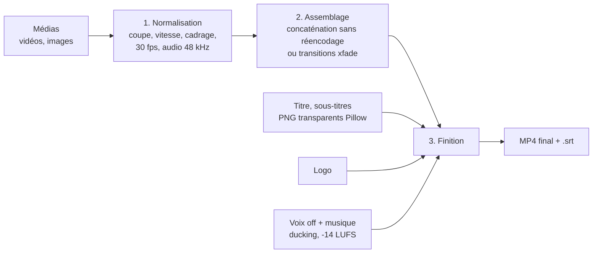

<p align="center"></p>

# Montage Studio Video (MSV)

Logiciel de montage vidéo **local** (rien n'est envoyé sur Internet), pensé pour produire vite des **Shorts 9:16**
et des **vidéos YouTube 16:9** : montage manuel à la main, ou production **en série** à partir d'un tableau.

Interface dans le navigateur (Gradio), moteur FFmpeg, texte rendu avec Pillow : identique sous Windows, macOS et Linux.

---

## 1. Installation (une seule fois)

| Système | Étapes |
|---|---|
| **Windows** | 1. Installer [Python 3.10+](https://www.python.org/downloads/) en cochant **« Add python.exe to PATH »**. 2. Double-cliquer sur `lancer_windows.bat`. |
| **macOS / Linux** | 1. Avoir Python 3.10+. 2. Dans un terminal : `./lancer_mac_linux.sh` |

Le premier lancement crée un environnement `.venv` et installe les dépendances (quelques minutes).
**FFmpeg est fourni automatiquement** par le paquet `imageio-ffmpeg` : rien d'autre à installer.
L'interface s'ouvre ensuite toute seule sur `http://127.0.0.1:7860`.
Elle est disponible en **français, anglais, italien et espagnol** : sélecteur FR · EN · IT · ES en haut à droite
(la langue du navigateur est choisie au premier lancement, puis ton dernier choix est mémorisé).

Installation manuelle si tu préfères :

```bash
python -m venv .venv
.venv\Scripts\activate          # Windows  (macOS/Linux : source .venv/bin/activate)
pip install -r requirements.txt
python app.py
```

**Option Whisper** (sous-titres automatiques au mot près, recommandé pour les vidéos filmées) :

```bash
pip install faster-whisper
```

Le modèle (`small` ≈ 500 Mo) est téléchargé au premier usage. Avec une carte NVIDIA il tourne sur le GPU, sinon sur le CPU.

---

## 2. Fonctions

| Fonction | Où | Détail |
|---|---|---|
| Couper des extraits | Inspecteur | Curseur image par image, boutons « Début = curseur » / « Fin = curseur » |
| Assembler | Timeline | Ordre, vitesse (0,5 à 4×), volume, cadrage horizontal, durée des images |
| Formats | Format et rendu | 9:16, 16:9, 1:1, 4:5 |
| Cadrage | Format et rendu | **flou** (fond flouté), **rogner** (plein écran), **bandes** (barres noires) |
| Transitions | Format et rendu | fondu enchaîné, fondu au noir, dissolution, glissements, balayage, zoom, cercle |
| Couper les silences | Audio | Détection automatique, seuil et durée réglables |
| Voix off | Audio | Volume, décalage |
| Musique | Audio | Bouclée sur toute la vidéo, fondus, **ducking** (baisse quand on parle) |
| Normalisation | Audio | -14 LUFS, le niveau visé par YouTube |
| Images fixes animées | Images fixes | Zoom avant / arrière (Ken Burns), réparties sur la durée de la voix off |
| Titre | Titre | Police, taille, couleur, position, bandeau, horaires |
| Sous-titres | Sous-titres | Script minuté automatiquement, fichier `.srt` ou Whisper ; **karaoké** (mot prononcé surligné) |
| Logo / filigrane | Logo | 5 positions, taille, opacité |
| Aperçu rapide | Bas de page | Demi-résolution, 3 à 5× plus rapide |
| Export | Bas de page | MP4 H.264 + AAC, `+faststart`, fichier `.srt` généré à côté |
| Accélération GPU | Encodeur | NVIDIA, Apple, Intel ; repli automatique sur le CPU si ça échoue |
| Projets | Projets et modèles | Sauvegarde / chargement en JSON |
| Série | Shorts en série | CSV ou dossier → N vidéos avec le même style |
| Miniatures | Outils rapides | Image de la vidéo + gros texte, 16:9 ou 9:16 |
| Vidéo → Short | Outils rapides | Un clic : 9:16 + silences coupés |
| Extraire l'audio | Outils rapides | MP3 |
| Transcription | Outils rapides | Audio/vidéo → `.srt` (Whisper) |
| **Voix off** | Voix off | Texte → voix avec **ElevenLabs** (ta clé API) ou **Piper** (gratuit, hors ligne) ; une piste par scène + `.srt` |
| Remplacer une voix | Voix off | Change la voix d'un clip existant, au même volume qu'un clip de référence |
| Voix auto en série | Shorts en série | Chaque ligne du CSV avec un `texte` reçoit sa voix off générée |

---

## 3. Comment ça marche



| Module | Rôle |
|---|---|
| `app.py` | Interface (onglets Montage, Shorts en série, Outils rapides, Aide) |
| `cli.py` | Même moteur en ligne de commande |
| `core/render.py` | Moteur : projet JSON → MP4 |
| `core/batch.py` | Production en série (CSV, dossier) |
| `core/subs.py` | SRT, minutage automatique, Whisper |
| `core/textimg.py` | Rendu du texte (titres, sous-titres, karaoké) |
| `core/tools.py` | Silences, captures, miniatures, audio |
| `core/ff.py` | Accès à FFmpeg, analyse des médias, progression |

Dossiers créés à l'usage : `medias/` (copies des fichiers importés), `sorties/` (vidéos), `projets/`, `cache/` (temporaire, vidé après chaque rendu).

---

## 4. Shorts en série

Le **modèle** fixe le style, le **tableau** fixe le contenu. Une ligne = une vidéo terminée.

| Colonne | Contenu | Exemple |
|---|---|---|
| `id` | Nom du fichier produit | `histoire_07` |
| `medias` | Fichiers séparés par `\|`, un dossier, ou un motif | `histoires/07/*.jpg` |
| `titre` | Titre affiché au début | `Le village englouti` |
| `texte` | Script des sous-titres | `En 1954, ...` |
| `srt` | Sous-titres déjà minutés (prioritaire sur `texte`) | `histoires/07/voix.srt` |
| `voix_off` | Narration | `histoires/07/voix.mp3` |
| `musique` | Fond musical | `musiques/tension.mp3` |
| `debut`, `fin` | Portion des vidéos à garder (s) | `12` / `58` |

Séparateur `;`, `,` ou tabulation (un export Excel ou Google Sheets en CSV fonctionne). Les chemins relatifs
partent du « dossier de base » indiqué dans l'interface. Une ligne en erreur n'arrête pas la série : elle est signalée dans le rapport.

**Règle automatique** : si une ligne a des images **et** une voix off, les images se répartissent sur toute la durée de la voix.

### Modèles fournis

| Modèle | Pour quoi | Points clés |
|---|---|---|
| `short_storytelling` | Histoires vraies narrées, images IA | 9:16, zoom avant, fondus, karaoké jaune au centre, musique à 12 % |
| `short_clip_parle` | Extraits filmés, interviews, vlogs | Fond flou, silences coupés, Whisper surligné en violet, titre Anton |
| `short_enfants` | Dessins animés pour tout-petits | Rythme doux, texte non capitalisé, couleurs chaudes |
| `video_youtube_16x9` | Vidéos longues | 16:9, fondus au noir, logo discret, sans sous-titres incrustés |

Pour créer le tien : règle tout dans l'onglet Montage, donne un nom au projet, puis « Enregistrer les réglages comme modèle de série ».

---

## 5. Ligne de commande

```bash
# Rendre un projet sauvegardé
python cli.py rendu projets/mon_projet.json -o sorties/final.mp4

# Une vidéo par ligne de CSV
python cli.py serie templates/short_storytelling.json exemples/serie_storytelling.csv --base D:/chaine --sortie sorties/lot1

# Une vidéo par fichier d'un dossier (59 s max)
python cli.py dossier templates/short_clip_parle.json D:/rushs --duree 59 --titre-nom --sortie sorties/clips
```

Pratique pour programmer un rendu de nuit (Planificateur de tâches Windows, cron).

---

## 6. Performances

| Situation | Ordre de grandeur sur un PC 8 cœurs (CPU) |
|---|---|
| Short 60 s, qualité « aperçu » | 10 à 20 s |
| Short 60 s, qualité « haute » | 40 à 90 s |
| Même chose avec NVENC (NVIDIA) | 2 à 3× plus rapide pour l'encodage final |

Astuces : travaille en « aperçu », n'exporte en « haute » qu'à la fin ; sans transition, l'assemblage se fait sans réencodage.

---

## 7. Dépannage

| Problème | Solution |
|---|---|
| `Python introuvable` | Réinstaller Python en cochant « Add python.exe to PATH » |
| Port 7860 occupé | L'app prend le port libre suivant, ou `python app.py --port 7900` |
| « Encodeur GPU indisponible » dans le journal | Normal sans carte compatible : le rendu continue sur le CPU |
| Sous-titres décalés en mode script | Le minutage est estimé : pour une synchro parfaite, utilise un `.srt` ou Whisper |
| Whisper ne se lance pas | `pip install faster-whisper` dans le `.venv`, puis relancer |
| Police manquante | Dépose un `.ttf` ou `.otf` dans `fonts/` (Google Fonts est gratuit) et relance |
| Erreur FFmpeg détaillée | Le message complet s'affiche ; la commande exacte est dans le résultat de `render_project` (`commands`) |

---

## Voix off

| | **Piper** | **ElevenLabs** |
|---|---|---|
| Prix | Gratuit | Selon ton abonnement ElevenLabs |
| Internet | Seulement pour télécharger la voix la 1re fois | Obligatoire |
| Qualité | Correcte, un peu synthétique | Très naturelle, voix clonées possibles |
| Sous-titres | Minutage estimé | Minutage **exact**, mot par mot |
| Voix | FR : Pierre, Tom, Gilles, Jessica, Siwis · EN : LibriTTS · ES : DaveFX, Sharvard | Toutes celles de ton compte |

**ElevenLabs** : sur elevenlabs.io, *Profile → API Keys*, crée une clé, colle-la dans l'onglet Voix off puis
« Charger mes voix ». La clé est mémorisée dans `voix_config.json` sur ton PC (ou mets-la dans la variable
`ELEVENLABS_API_KEY`). Ce fichier est exclu de Git : ne le partage jamais.

**Scènes** : sépare-les par une ligne `---`. ElevenLabs reçoit le texte des scènes voisines pour garder une intonation continue.

**Licences des voix Piper** : seules les voix autorisant l'usage commercial sont proposées (détails dans `TIERS.md`).

Ligne de commande :

```bash
python cli.py voix script.txt --voix "Pierre — homme, français" --hauteur -1 --nom histoire_07
python cli.py voix "Bonjour" --moteur elevenlabs --voix <voice_id>
python cli.py voix-liste
```

---

## 8. Licences

Montage Studio est un logiciel libre distribué sous **GPL-3.0-or-later** (fichier `LICENSE`) : tu peux l'utiliser,
le modifier, le redistribuer et même le vendre, à condition de garder la même licence et de fournir le code source.
Cette licence est imposée par FFmpeg (compilé avec x264, sous GPL).

Les composants tiers (FFmpeg, polices Anton et Montserrat, voix Piper, bibliothèques Python) et leurs licences sont listés
dans `TIERS.md`. Vérifie toujours les droits des musiques et des images que tu utilises dans tes vidéos.
